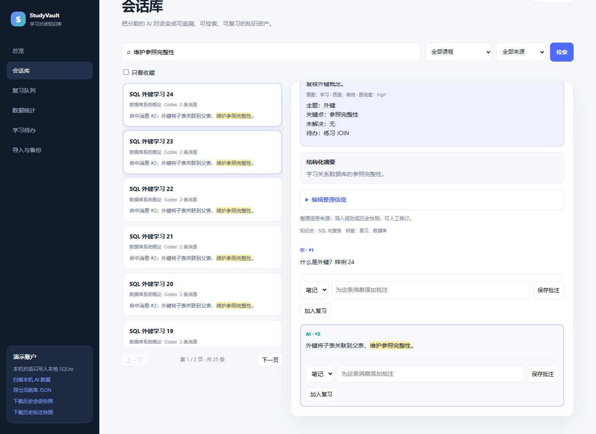
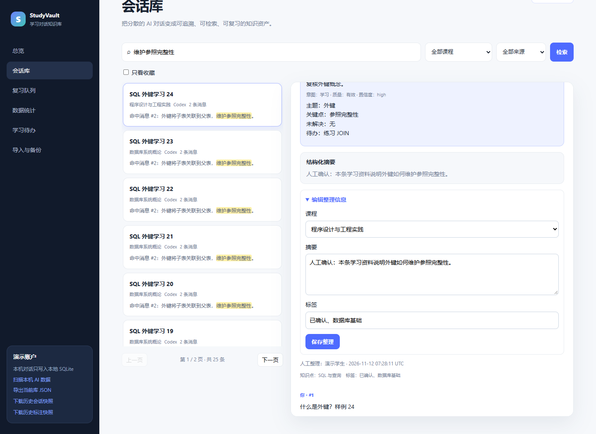
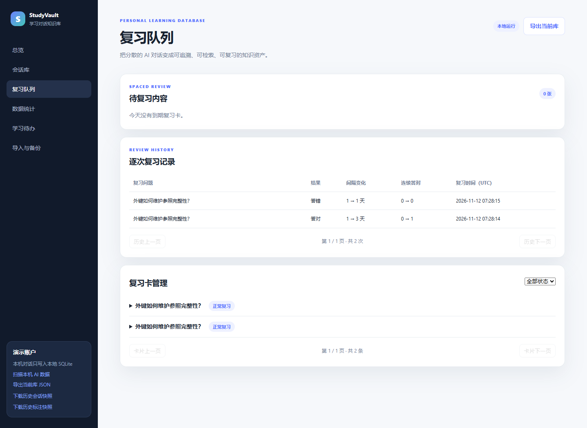

# StudyVault 附加功能与相关研究

## 1. 本轮增加的内容

在现有“导入 → 检索阅读 → 批注 → 复习 → 统计导出”上，落实三项优先改进：

| 编号 | 附加功能 | 状态 | 页面入口 |
| --- | --- | --- | --- |
| A01 | 搜索匹配片段、高亮和命中消息定位 | 已实现并验证 | 会话库输入关键词，点击结果。 |
| A02 | 人工修订课程、摘要和标签，保留整理来源与时间 | 已实现并验证 | 会话详情 → 编辑整理信息。 |
| A03 | 逐次复习日志、历史分页及累计答题统计 | 已实现并验证 | 复习队列 → 逐次复习记录；数据统计 → 累计复习。 |

本轮采用下述资料中的设计思路，在现有代码中实现；没有引入这些项目的整套代码或 FSRS 调度依赖。其余方向在第 6 节单独列为待扩展，不能视为已完成。

## 2. A01：命中消息定位

### 需求与交互

原来检索只返回会话，用户需要再翻阅正文寻找答案。现在结果项显示命中消息序号和前后片段，对关键词高亮；点击结果后打开完整上下文，并滚动到匹配消息。

- 按消息序号选择该会话的第一条匹配消息，作为本次定位目标。
- 只有标题匹配时正常打开会话，不伪造命中消息。
- 普通关键词按字面匹配，`%`、`_` 和反斜杠不作为用户可执行的 SQL 通配语法。
- 搜索片段、标题和消息先做 HTML 转义再插入高亮标记，不把消息中的 HTML 当作页面元素执行。
- 保留原有课程/来源筛选、20 条分页、稳定排序和迟到响应保护。

### 接口与实现

`GET /api/conversations` 保留原返回结构，每个 `items` 元素新增：

| 字段 | 类型 | 含义 |
| --- | --- | --- |
| `matched_message_id` | integer 或 null | 可直接定位的命中消息。 |
| `match_seq_no` | integer 或 null | 消息在原会话中的序号。 |
| `match_snippet` | string 或 null | 附近正文片段；不是大模型生成的摘要。 |

实现位置：`app.py:conversations`；`static/app.js:highlightHtml`、`loadConversations`、`openConversation`。SQL 在已有用户过滤后的会话内，按 `seq_no` 查询匹配正文，保持原消息和会话 ID 的对应关系。

### 验收与效果

后端测试验证匹配 ID 与详情中的原消息一致，`%` 和 `_literal` 按字面检索。真实 Edge 页面验证结果片段与正文高亮，并直接定位到第 2 条消息。

下图使用 25 个受控会话样例进行操作演示，不是历史语料的统计结果。



## 3. A02：人工整理与可追溯修订

### 需求与交互

导入规则和历史标签可能存在误分类。用户可以在会话详情展开“编辑整理信息”，选择课程、修改摘要、增删标签。标签支持逗号或顿号分隔，留空表示清空；摘要要求非空。

保存后更新会话详情、列表和总览，展示最近整理人及 UTC 时间；原始消息正文、会话来源、历史深读标注及复习进度保持不变。若改课后会话不再满足当前筛选，页面清除失效选中项。

### 接口与一致性

新增 `PATCH /api/conversations/{conversation_id}`，允许部分提交：

```json
{
  "course_id": 2,
  "summary": "经人工核对的学习摘要",
  "tags": ["已确认", "待练习"]
}
```

- 可省略不修改的字段；无有效字段、空白摘要、空白标签或不存在的课程返回 400，不存在或无权访问的会话返回 404。
- 标签去重并去除首尾空白；`tags: []` 明确表示移除全部标签。
- 会话改课时，将关联知识点按名称迁入目标课程，保留关联置信度，避免会话和知识点课程脱节。
- `audit_log` 使用 `CURATE` 操作保存修改前后数据及累计人工维护字段；详情新增 `curation`，包含整理人、时间及人工维护字段。
- 恢复快照时保留人工修订。特别是人工删掉的旧标签不会因为再次恢复而重新出现；后续只修改摘要也不会丢失此前的标签人工维护标记。

实现位置：`app.py:CurationInput`、`curate_conversation`、`latest_curation`、`restore_bundled`；`static/app.js:openConversation` 的整理表单。整理修改和审计日志在同一事务内提交。

### 验收与效果

测试覆盖部分更新、无效输入无部分写入、知识点课程一致性、原始消息不变、审计前后值，以及重复恢复后人工整理和标签删除仍保留。浏览器验证三个输入字段可操作，保存后显示人工整理来源。



## 4. A03：逐次复习历史

### 需求与数据模型

现有 `review_count` 是连续答对次数，答错后归零，不能用于计算累计复习次数。因此新增独立 `review_log` 表，每次有效完成复习写一行：

| 字段 | 说明 |
| --- | --- |
| `review_log_id` | 日志主键。 |
| `review_card_id` | 外键指向复习卡，卡片删除时级联删除日志。 |
| `reviewed_at` | 本次复习 UTC 时间。 |
| `grade` | correct 或 wrong。 |
| `interval_before` / `interval_after` | 本次操作前后的间隔天数。 |
| `streak_before` / `streak_after` | 本次操作前后的连续答对次数。 |
| `due_before` / `due_after` | 本次操作前后的到期时间。 |

DDL 与索引集中在 `schema.sql`；旧数据库下一次启动通过 `CREATE TABLE IF NOT EXISTS` 增加新表，基础 15 张表不重建。本阶段增加日志后为 16 张，随后可用性增强再增加阅读状态与偏好表，当前共 18 张。此前未记录的复习不补造，已有卡片的进度原样保留。

### 接口与页面

- `POST /api/reviews/{review_id}/complete` 请求和卡片返回字段不变；状态更新与日志插入在同一写事务内完成，任一失败全部回滚。
- 新增 `GET /api/reviews/history?review_card_id=...&limit=20&offset=0`。卡片筛选可省略；返回 `items`、`total`、`limit`、`offset`，按时间和日志 ID 倒序。只可查看当前用户的卡片；访问其他用户卡片返回 404。
- 复习队列下方提供历史上一页/下一页，每页 20 次，显示结果、间隔变化、连续答对变化和时间。
- `/api/stats` 新增 `reviews`：`total`、`correct`、`wrong`，页面展示累计次数；统计只依赖已记录的真实日志。
- 新卡创建、重复建卡及仅浏览队列不产生复习日志；现有固定间隔算法保持不变。本轮未接入 FSRS。

实现位置：`app.py:complete_review`、`review_history`、`stats`；`static/app.js:loadReviewHistory`、`loadReviews`、`loadStats`。

### 验收与效果

测试验证答对/答错各保留一条记录，重复建卡不添日志，历史分页无重复，其他用户数据不计入，以及旧库升级不会补造历史。通过故意让日志插入失败，确认卡片状态也一起回滚。

浏览器完成两张卡片的一次答对、一次答错，再刷新页面，仍能看到两次复习记录和对应统计。



## 5. 相关论文与开源项目

下表的“借鉴到本项目”是本轮结合 hw2 提出的应用方案。论文实验与开源项目的效果不等同于本项目已经取得的效果。

| 资料 | 相关工作 | 借鉴到本项目 | 本轮状态 |
| --- | --- | --- | --- |
| [Nexus AI Chat Importer：架构文档](https://github.com/superkikim/nexus-ai-chat-importer/blob/HEAD/docs/architecture/README.md)；[项目功能](https://community.obsidian.md/plugins/nexus-ai-chat-importer) | 不同平台经适配器转换为统一会话结构，生成 Markdown；提供重复导入与增量整理能力。 | 将平台解析逻辑拆成独立适配器；统一校验和导入报告，降低增加平台时的改动范围。 | 已记录设计方向；尚未拆分现有导入器，尚未实现增量同步。 |
| [Open WebUI：History & Search](https://docs.openwebui.com/features/chat-conversations/chat-features/history-search/) | 对历史对话标题与正文检索，展示匹配片段、高亮，并打开匹配消息位置。 | A01 的片段展示、关键词高亮和原始消息定位。 | 已落实对应交互。 |
| [Py-FSRS](https://github.com/open-spaced-repetition/py-fsrs) | Python 间隔复习调度库，提供卡片状态、四档评价、复习日志及参数优化入口。 | 先建立 A03 的逐次日志，保留后续调度和效果分析所需数据；再评估算法接入。 | 日志和统计已落实；FSRS、四档评价和参数优化尚未接入。 |
| Suh 等，[Sensecape: Enabling Multilevel Exploration and Sensemaking with Large Language Models](https://arxiv.org/abs/2305.11483)，UIST 2023；[会议 DOI](https://doi.org/10.1145/3586183.3606756) | 通过多层次抽象组织信息，支持在探索与知识整理之间切换。 | 用“课程 → 知识点 → 会话 → 消息证据”组织层级导航，复用现有知识点父子关系。 | 已记录后续方案；层级浏览界面尚未实现。 |
| Huang 等，[Memory Sandbox: Transparent and Interactive Memory Management for Conversational Agents](https://arxiv.org/abs/2308.01542)，2023 年 arXiv 论文 | 将对话记忆视为用户可查看、操作、总结和跨会话管理的数据对象。 | A02 借鉴用户可控制整理结果的思路，提供人工修订和来源记录。 | 人工整理已落实；模型侧记忆注入不在本轮范围。 |
| Li 等，[When Your Agent Opens the Chat App: Agent-Controlled Search over Raw Chat Logs Rivals Structured Memory](https://arxiv.org/abs/2608.12888)，2026 年 arXiv 预印本，系统名 ReFind | 在未改写的原始聊天日志上按消息检索，结合上下文展开与时间缩小范围收集证据。 | A01 保留命中消息到原始上下文的追溯；后续可加入时间范围筛选及上下文局部展开。 | 原始证据定位已落实；代理检索循环、BM25 与论文中的实验系统未实现。 |

报告中的贡献可表述为：**面向课程学习，将多来源 AI 对话归档、原始消息证据追溯、可修订的学习整理信息，以及逐次复习记录整合到关系数据库应用中。**

## 6. 待扩展功能与研究评估

以下保持待实现状态，不列入本轮已完成功能：

1. **平台导入器拆分与增量同步**：为每个平台定义相同的解析输出契约，分别测试；新增消息应按稳定消息标识去重追加，不能覆盖已有批注与卡片。
2. **层级知识点导航**：课程下展开知识点和子知识点，查看关联会话并跳转消息。现有课程筛选和标签显示仍然保留。
3. **FSRS 调度**：增加算法所需卡片状态与四档评价，明确旧卡片迁移规则后再接入；A03 日志只是基础，不能声称当前固定间隔已经是 FSRS。
4. **时间范围检索与上下文展开**：按日期收窄检索结果，在命中消息附近展开上下文，适用于原始会话较长的情况。
5. **检索任务评估**：事先定义一组找回知识或代码片段的任务，对比普通聊天历史与 StudyVault 的查找耗时、成功率和误命中情况；记录参与者、题目、顺序安排与原始结果。目前没有开展用户实验，不报告效率提升数值。

## 7. 验证、证据和运行

```powershell
uv run --group dev python -m unittest discover -s tests -v
uv run --group dev python tests/browser_check.py
uv run --group dev python tests/additional_browser_check.py
```

本阶段后端为 **24 项测试**，随后七项可用性增强再增加 10 项，当前 **34 项**。本阶段浏览器检查使用临时数据库中的 25 个受控会话，不改写工作区历史语料或日常数据库，截图输出到 `docs/screenshots-additional/`。

结构化结果见 [ADDITIONAL_FEATURES_EVIDENCE.json](ADDITIONAL_FEATURES_EVIDENCE.json)。原 8 张历史语料演示截图保留在主报告；本文件的 3 张附加截图使用受控样例，两套证据的数据来源分别注明。

现有用户重启服务即可创建空的 `review_log` 表并启用新功能。快照中的会话、消息和会话标注数量不因本次附加功能发生变化。

## 8. 后续已落实的七项可用性功能

本轮在上述三项功能后继续落实了以下内容，完整输入输出、接口、数据库变化、运行约束、8 张截图和验收结果见 [七项可用性增强](USABILITY_FEATURES.md)，实施前计划见 [USABILITY_PLAN.md](USABILITY_PLAN.md)。

| 编号 | 功能 | 状态 |
| --- | --- | --- |
| A04 / U01 | 先回忆再显示答案，空格揭晓、1/2 评分 | 已实现并验证。 |
| A05 / U02 | 完整库备份、恢复预览、确认应用、恢复前快照 | 已实现并验证。 |
| A06 / U03 | 学习待办、解决/重开、原消息跳转 | 已实现并验证。 |
| A07 / U04 | Markdown/公式/表格/代码排版与复制 | 已实现并验证。 |
| A08 / U05 | 卡片编辑、暂停/恢复、到期日期调整 | 已实现并验证。 |
| A09 / U06 | 收藏筛选、最近阅读、筛选页码及消息位置保存 | 已实现并验证。 |
| A10 / U07 | Agent 文件预览、选择导入、后台进度及停止 | 已实现并验证。 |

平台适配器进一步拆分、同一会话增量同步、知识点层级导航、FSRS 调度和用户检索效率实验仍保持第 6 节的待扩展状态。新增“上传预览”复用现有平台解析，不代表上述方向已经全部完成。
