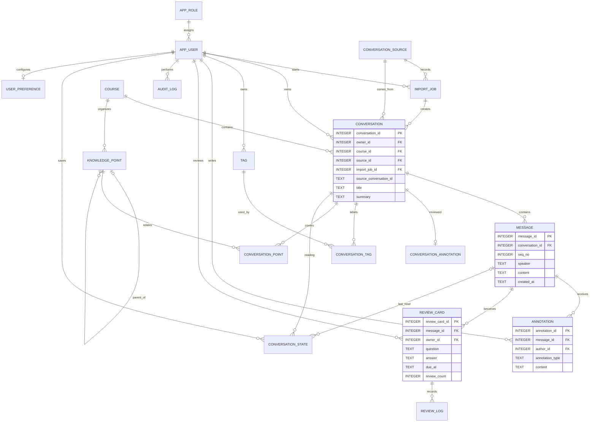
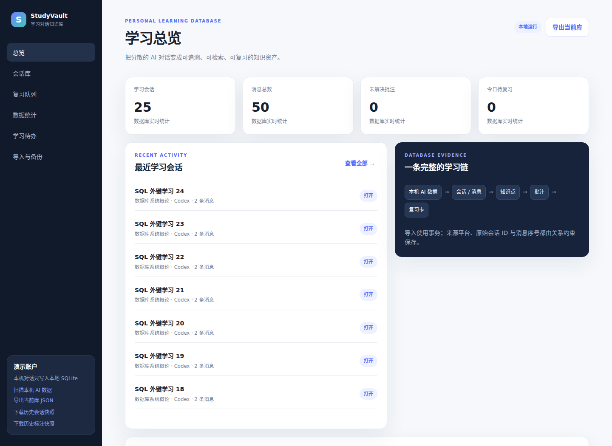
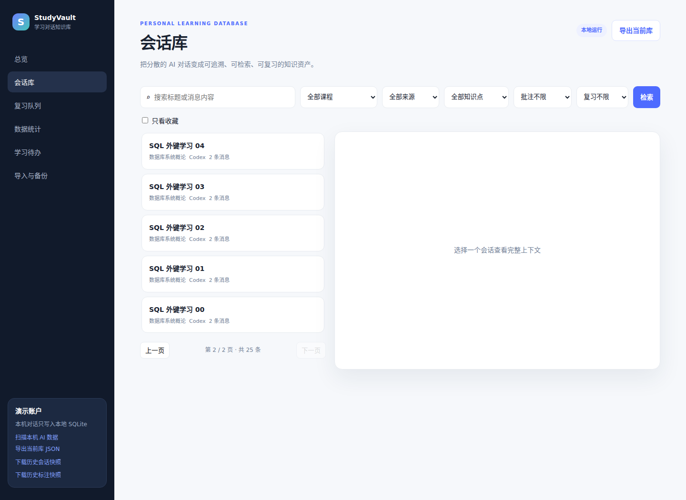
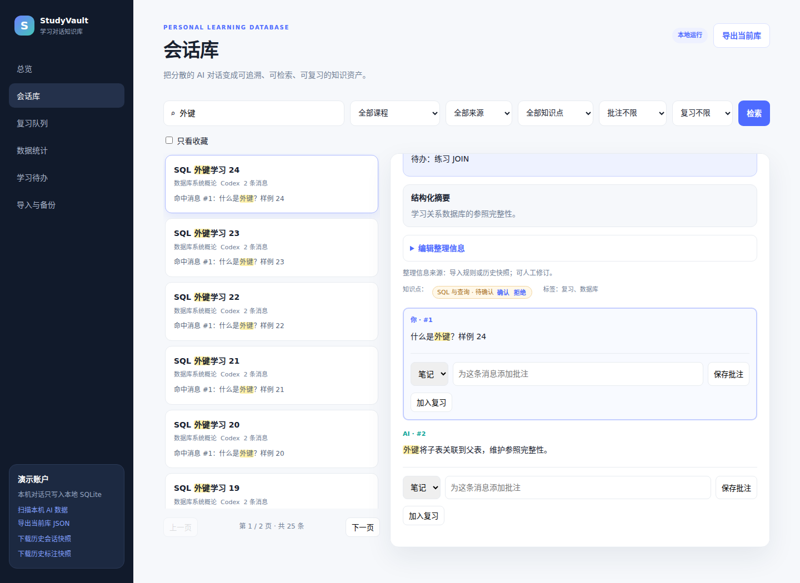
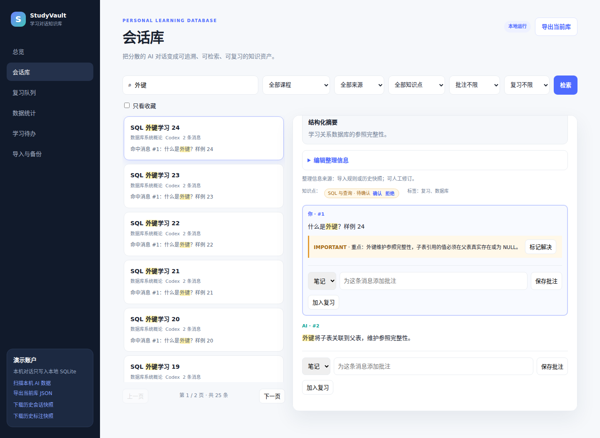
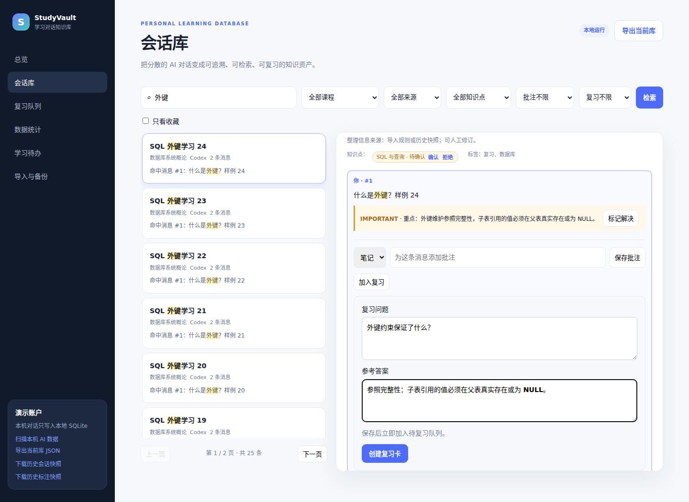
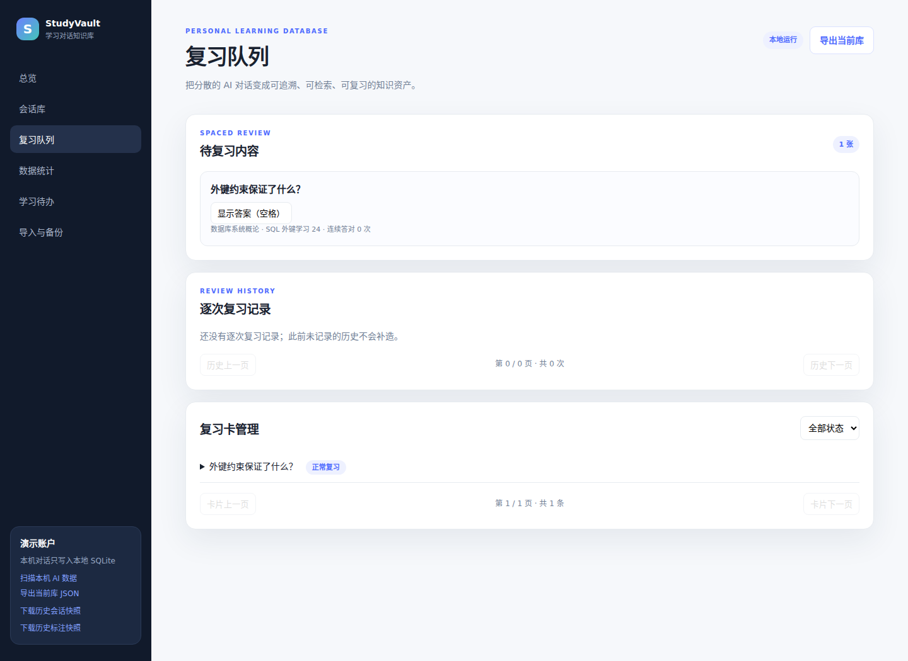
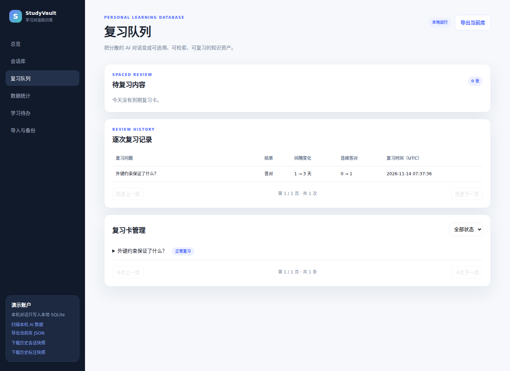
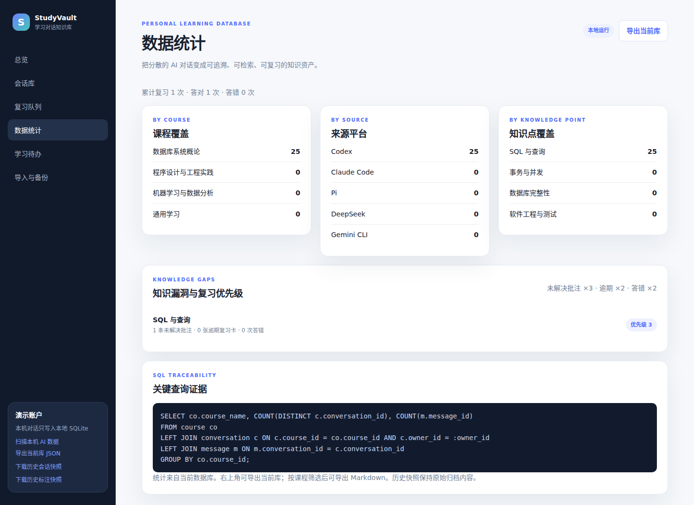

# StudyVault：个人学习空间项目报告

## 1. 应用场景、需求和证据口径

学生通过不同 Agent 工具理解知识点、处理课程作业和辅助编程，对话按工具与时间分散保存。StudyVault 将可读取的会话正文导入 SQLite，以会话为整理单位关联课程、标签和知识点，在消息级保存批注，再把需要巩固的内容变成复习卡。

用户为单个本地学习者。完整使用流程为“恢复/导入 → 分类检索 → 阅读上下文 → 添加批注 → 创建并完成复习 → 统计与导出”。本项目使用固定演示用户，角色表是预留关系数据，不代表实现了登录或多角色权限。

本报告区分三类证据：

- **本机真实语料（不随仓库公开）**：系统在作者本机的 754 个真实会话、37,610 条消息（跨 Codex、Claude Code、Pi、DeepSeek、Gemini CLI 五种工具）上开发与验证。这些对话含个人信息，按 [DATA_POLICY.md](../DATA_POLICY.md) **只保存在本机、不提交版本库**；下文的 754/37,610 等数字用于说明真实语料规模，不是仓库附带内容。
- **仓库附带的合成演示快照**：为便于在其他机器复现，仓库提供一份**人工编写、不含真实对话**的合成快照（14 个学习问答、56 条消息）。`--restore-bundled` 从空库恢复的就是这份合成数据。原快照未保存课程字段，因此课程归属由现有规则重新推断。
- **本轮实测**：临时数据库中的 API 和真实浏览器检查，以及从合成演示夹具拍摄的页面截图。截图演示新增一条消息重点批注和一张复习卡，未改写原始问答。

作业依据为老师 PPT 的参考选题 2（第 12—20 页）。Text2SQL 为参考方向；本轮不扩展视频、汇报 PPT、Text2SQL 或本机会话增量同步。

## 2. 数据库设计

### 2.1 E-R 图

下图的 `o|` 表示可选的至多一条记录，`o{` 表示零到多条。一个会话可以没有深读标注；知识点也可以没有父节点。



### 2.2 关系模式与数据字典

基础 15 张表及附加的复习日志、阅读状态、偏好表的完整 DDL 见 [schema.sql](../schema.sql)。当前共 18 张表；`app.py:SCHEMA` 直接读取该文件，`init_db()` 执行同一份定义。

| 表 | 字段 | 主键、外键和主要约束 |
| --- | --- | --- |
| `app_role` | role_id、role_code、role_name | PK role_id；role_code 唯一。 |
| `app_user` | user_id、role_id、username、display_name、status、created_at | PK user_id；FK role_id → app_role；username 唯一；status 限 ACTIVE/DISABLED。 |
| `course` | course_id、course_code、course_name、term、instructor_name、description、status、created_at | PK course_id；course_code 唯一；status 限 ACTIVE/ARCHIVED。 |
| `knowledge_point` | point_id、course_id、parent_id、point_name、description、level_no | PK point_id；FK course_id → course、parent_id → 本表；UNIQUE(course_id,point_name)；level_no > 0。 |
| `conversation_source` | source_id、platform_name、source_type、source_path | PK source_id；UNIQUE(platform_name,source_type)。 |
| `import_job` | import_job_id、owner_id、source_id、file_name、source_conversation_id、status、total_messages、error_message、created_at | PK import_job_id；FK owner_id/source_id；UNIQUE(owner_id,source_id,file_name,source_conversation_id)；状态限 SUCCESS/SKIPPED/FAILED。 |
| `conversation` | conversation_id、owner_id、course_id、source_id、import_job_id、source_conversation_id、title、summary、visibility、started_at、updated_at | PK conversation_id；四个 FK 指向用户/课程/来源/导入；UNIQUE(owner_id,source_id,source_conversation_id)；visibility 限 PRIVATE/SHARED。 |
| `message` | message_id、conversation_id、seq_no、speaker、content、created_at | PK message_id；FK conversation_id；UNIQUE(conversation_id,seq_no)；speaker 限 user/assistant/system。 |
| `tag` | tag_id、owner_id、tag_name | PK tag_id；FK owner_id；UNIQUE(owner_id,tag_name)。 |
| `conversation_tag` | conversation_id、tag_id | 复合 PK；两个 FK，表达会话与标签的多对多关系。 |
| `conversation_point` | conversation_id、point_id、confidence、source | 复合 PK；两个 FK；confidence 在 [0,1] 内。 |
| `conversation_annotation` | annotation_id、conversation_id、summary_manual、intent、topics_json、key_points_json、unresolved_questions_json、action_items_json、quality、confidence、created_at、updated_at | PK annotation_id；FK conversation_id 且唯一；quality 限有效/混合/低价值，confidence 限 high/medium/low。 |
| `annotation` | annotation_id、message_id、author_id、annotation_type、content、is_resolved、created_at、updated_at | PK annotation_id；FK message_id/author_id；类型限 NOTE/QUESTION/CORRECTION/IMPORTANT；is_resolved 为 0/1。 |
| `review_card` | review_card_id、message_id、owner_id、question、answer、due_at、interval_days、review_count、status、last_reviewed_at | PK review_card_id；FK message_id/owner_id；UNIQUE(owner_id,message_id)；状态限 ACTIVE/SUSPENDED/COMPLETED。 |
| `audit_log` | audit_id、actor_id、operation、table_name、record_id、before_data、after_data、created_at | PK audit_id；FK actor_id；保存导入、恢复和批注操作的审计数据。 |
| `review_log` | review_log_id、review_card_id、reviewed_at、grade、interval_before、interval_after、streak_before、streak_after、due_before、due_after | PK review_log_id；FK review_card_id → review_card；grade 限 correct/wrong；逐次保留复习前后状态。 |
| `conversation_state` | owner_id、conversation_id、is_favorite、last_message_id、last_opened_at | 复合 PK owner_id/conversation_id；FK 到用户/会话/消息；保存收藏与阅读进度。 |
| `user_preference` | user_id、library_state | PK/FK user_id → app_user；保存筛选、页码、会话及上次视图。 |

会话删除时，其消息、关联表和会话标注级联删除；消息删除时批注和复习卡级联删除。课程及知识点父节点使用 RESTRICT，避免误删被引用实体。每次连接都启用 SQLite 外键检查，恢复事务内还执行完整性检查。

索引覆盖课程/更新时间、消息会话/序号、复习到期状态和消息批注。关键词检索当前使用 `LIKE`，不是全文检索引擎；本轮约 3.8 万条消息的运行结果不能外推为大规模数据性能结论。

### 2.3 设计理由和边界

课程、来源、会话、消息、标签、批注分别建表，避免重复存储课程名称和平台名称。标签、知识点通过中间表表达多对多关系，批注不覆盖原始消息。深读标注中的列表以 JSON 保存，方便保留历史标注格式；可检索的正式标签和知识点仍在独立关系表中。

本项目将课程与标签关联到会话，而老师参考图关联到消息，这是自行设计的粒度选择：一个完整问答上下文被视为一个学习资料单元。当前一个会话只有一门课程，跨课程会话依靠标签/知识点补充表达；附加功能现已支持人工改课、摘要和标签修订，多课程归属仍未实现。现有关键词规则可能把数学学习中的 Markdown 编辑归入程序设计，原 8 张截图保留的是整改基础阶段的实际分类；新增人工整理界面见附加功能文档。

`review_count` 沿用既有算法，表示连续答对次数：答错归零，不是累计复习次数。页面已相应改为“连续答对”。

## 3. 数据来源与完整恢复

### 3.1 附带快照数量

| 来源 | 会话 | 消息 |
| --- | ---: | ---: |
| Codex | 591 | 36,747 |
| Claude Code | 136 | 439 |
| Pi | 6 | 24 |
| DeepSeek | 7 | 118 |
| Gemini CLI | 14 | 282 |
| 合计 | 754 | 37,610 |

上表为**本机真实语料**的规模（按 DATA_POLICY.md 不随仓库公开）：754 个唯一的“来源平台＋原始会话 ID”，5,826 条用户正文和 31,784 条助手正文，标注质量分布为有效 417、混合 168、低价值 169。

**仓库附带的是合成演示快照**（`staging/structured_manifest_final.jsonl` 与 `staging/manual_annotations_all.jsonl`，内容为人工编写的虚构学习问答）。空库对合成快照实测恢复结果：14 个会话、56 条消息、14 条会话标注、19 条标签关联、14 条知识点关联。`PRAGMA integrity_check` 为 `ok`，外键违规数为 0。重复恢复新增会话和消息均为 0。真实语料的恢复流程与此一致，只是数量为上表规模。

课程重建使用标题与前十条消息的既有规则。本轮分布为程序设计与工程实践 456、通用学习 179、数据库系统概论 104、机器学习与数据分析 15；不声称还原了原机器未附带的课程分类。

### 3.2 可复现流程和冲突处理

```powershell
cd D:\Database\hw2
uv sync
uv run python app.py --restore-bundled
uv run uvicorn app:app --host 127.0.0.1 --port 8765
```

恢复先完整校验两个 JSONL，再初始化表和基础种子数据；批量数据写入使用 `BEGIN IMMEDIATE` 事务。缺文件、坏 JSON、重复标识、消息计数错误、字段不合法或标注不对应都会失败。已有会话按消息序号、发送者、正文和时间逐项比对；内容冲突抛错，事务中的所有会话/消息/关联/标注修改回滚。

已有且消息一致的记录保留 ID、非空摘要和已有会话标注，只补缺失摘要与关联。用户新增的消息批注、复习卡和复习进度不会被恢复覆盖。每次成功恢复额外记一条恢复审计记录。首次初始化创建表和基础种子数据，与之后的批量恢复事务分开；冲突不会清空库或回滚此前已有的用户工作。

直接扫描当前机器是另一条导入路径：支持多个 Agent 文件格式，但不会加载附带快照，也不生成深读标注；同一来源会话再次扫描会跳过，未实现后续消息的增量同步。

## 4. 逐功能需求拆解与实现

以下代码位置采用“文件＋函数名”定位，避免行号随整改漂移。SQL 编号对应下一节。

### R01-F01 解析、清理与校验本机记录

- **输入/前置条件**：可读取的 JSON/JSONL Agent 会话；压缩文件额外要求 zstd。输出规范化来源 ID、标题、用户/助手消息和时间；无正文时返回跳过原因，解压失败时报错。
- **设计/位置**：尚不操作数据库；字段映射、文本提取、上下文清理及确定性凭据脱敏。`app.py:iter_records`、`parse_conversation`、`clean_import_text`、`redact_sensitive`。
- **效果**：原有 4 个测试验证 Codex/DeepSeek 解析、脱敏、噪声过滤和课程识别；这不代表对每种格式版本做了兼容性保证。

### R01-F02 扫描、查重与事务入库

- **输入/前置条件**：配置的本机来源目录，表已初始化。输出扫描/新增/跳过数量；重复来源 ID 不再入库，没有正文的文件跳过。
- **设计/位置**：`conversation_source`、`import_job`、`conversation`、`message`、标签/知识点中间表、`audit_log`；先 Q01 查重，每个文件在一次事务中写入。接口 `POST /api/import/scan`；`app.py:source_files`、`scan_and_import`、`import_file`。
- **效果**：保留已有来源可追溯链路。此路径与完整快照恢复分别说明，不再把“扫描当前机器”当成重现历史数据的方法。

### R01-F03 完整快照恢复

- **输入/前置条件**：两份最终 JSONL 必须齐备且一一对应。输出新增、跳过、补齐及完整性检查结果；失败退出码为 1，同标识内容冲突时整批回滚。
- **设计/位置**：涉及全部学习记录表，按来源 ID 恢复而非复用旧数据库整数主键。Q01、Q02；命令 `python app.py --restore-bundled`；`app.py:read_bundle`、`restore_bundled`。
- **效果**：新库达到第 3 节的全部数量，重复恢复不增量复制；见总览截图 S01、结构化证据和恢复测试。

### R02-F01 关键词与课程/来源检索

- **输入/前置条件**：关键词、可选 course_id/source_id。输出匹配会话及总数；无匹配时显示空状态。
- **设计/位置**：`conversation`、`message`、`course`、`conversation_source`，标题 `LIKE` 或消息 `EXISTS`；Q03。接口 `GET /api/conversations`；`app.py:conversations`；`static/app.js:resetSearch`、`loadConversations`。
- **效果**：按正文也能找到会话；改变条件回到第一页。截图 S03 搜索“外键”后找到合成演示会话。

### R02-F02 数据库分页与页面导航

- **输入/前置条件**：当前筛选条件、每页 20 条及 offset。输出页内记录、总数、页码和按钮状态；第一页禁用上一页，末页禁用下一页。
- **设计/位置**：Q03 的 `LIMIT/OFFSET` 在 SQL 中执行；同更新时间按 conversation_id 降序稳定排序。接口不改变返回字段；`app.py:conversations`；`static/app.js:updatePagination`、`loadConversations`。
- **效果**：25 条合成演示会话分成 20/5 两页；截图 S02 显示第 2/2 页。新筛选或翻页清除失效选中项，迟到响应不覆盖新结果。

### R02-F03 阅读上下文与结构化信息

- **输入/前置条件**：当前用户拥有的 conversation_id。输出按序消息、摘要、标签、知识点、已有消息批注、复习卡和历史深读标注；不存在或不可访问返回 404。
- **设计/位置**：Q04；接口 `GET /api/conversations/{conversation_id}`；`app.py:conversation_detail`；`static/app.js:openConversation`、`updateSelection`。
- **效果**：截图 S03。详情不再反向加载列表；单次打开后无持续请求，草稿输入稳定。列表和详情分别用请求序号处理迟到响应。

### R03-F01 消息级批注

- **输入/前置条件**：可访问的 message_id、合法批注类型及非空正文。输出新批注并记录审计；非法类型/空白返回 400，不可访问返回 403。
- **设计/位置**：`annotation`、`message`、`conversation`、`audit_log`；Q05。接口 `POST /api/annotations`；`app.py:create_annotation`；`static/app.js:openConversation` 内的表单处理。
- **效果**：原始正文不变，批注独立保存。截图 S04 在合成外键问答下添加重点，刷新详情与总览统计，不循环刷新列表。

### R03-F02 从消息创建复习卡

- **输入/前置条件**：可访问的 message_id，以及非空问题、答案。答案预填消息正文，可编辑；输出复习卡，立即到期；空白返回 400，不可访问返回 403。
- **设计/位置**：`review_card`、`message`、`conversation`；Q06。接口仍为 `POST /api/reviews`，请求字段不变；`app.py:create_review`；`static/app.js:openConversation` 的建卡表单。
- **效果**：截图 S05 填写整理后的问题答案，S06 立即出现待复习卡。已有卡片显示“已加入复习”，重复 API 提交返回已有记录，不清除计划与进度。

### R03-F03 到期查询与答题状态更新

- **输入/前置条件**：到期卡或本人 review_id，以及 correct/wrong。输出当前到期队列或下一次到期时间；无卡显示空状态，不存在返回 404，非法 grade 返回 422。
- **设计/位置**：`review_card` JOIN 消息/会话/课程；Q07。接口 `GET /api/reviews/due`、`POST /api/reviews/{review_id}/complete`；`app.py:due_reviews`、`complete_review`；`static/app.js:loadReviews`。
- **效果**：答对连续次数增加，安排 3/7/14 天；答错归零并延后 1 天。S06→S07 展示答对后退出当期待复习列表；浏览器检查另覆盖答错分支。

### R04-F01 学习分布统计

- **输入/前置条件**：固定当前用户。输出课程、来源、知识点会话分布及课程消息数，空分类显示 0。
- **设计/位置**：`LEFT JOIN` 保留无记录课程/来源，课程消息计数用 `COUNT(DISTINCT conversation_id)` 避免被消息数放大；Q08。知识点按名称合并跨课程同名节点，只统计属于当前用户的匹配会话。接口 `GET /api/stats`；`app.py:stats`；`static/app.js:loadStats`。
- **效果**：S08 与恢复数据一致；测试加入另一用户的关联，当前用户的知识点计数不增长。

### R04-F02 导出当前会话资料与历史快照

- **输入/前置条件**：导出当前库，或选择已有 course_id；历史快照文件需存在。输出当前库会话 JSON、课程问答 Markdown，或固定历史快照 JSONL；不存在课程/快照返回 404。
- **设计/位置**：当前库/课程导出使用 Q09 的实时 SELECT，快照通过 `FileResponse` 下载原文件。接口 `/api/export/conversations.json`、`/api/export/course/{course_id}.md`、`/api/export/structured.jsonl`、`/api/export/manual-annotations.jsonl`；`app.py:export_json`、`export_course`、`export_structured`、`export_manual_annotations`。
- **效果**：右上角和侧栏导出当前库，课程筛选后显示 Markdown 导出；S08 展示入口与统计。浏览器实测下载 JSON/Markdown 内容与受控数据库一致，两份历史快照下载 SHA-256 与归档文件一致。上述资料导出不包含完整批注/复习状态，不替代 SQLite 备份；当前未提供统计 CSV 下载。

## 5. 关键 SQL 与实现方案

以下是对应实现的关键片段，参数均通过 SQLite 参数绑定传入；报告为便于阅读使用命名参数。

### Q01 来源会话查重

```sql
SELECT conversation_id FROM conversation
WHERE owner_id=:owner_id AND source_id=:source_id
  AND source_conversation_id=:original_id;
```

### Q02 原始消息写入与关联补齐

```sql
INSERT INTO message(conversation_id,seq_no,speaker,content,created_at)
VALUES(:conversation_id,:seq_no,:speaker,:content,:created_at);
INSERT OR IGNORE INTO conversation_tag(conversation_id,tag_id)
VALUES(:conversation_id,:tag_id);
INSERT OR IGNORE INTO conversation_point(conversation_id,point_id,source)
VALUES(:conversation_id,:point_id,'bundled');
PRAGMA integrity_check;
PRAGMA foreign_key_check;
```

### Q03 搜索、筛选与后端分页

```sql
SELECT c.conversation_id,c.title,c.updated_at,c.started_at,
       s.platform_name,co.course_name,COUNT(m.message_id) AS message_count
FROM conversation c
JOIN conversation_source s ON s.source_id=c.source_id
JOIN course co ON co.course_id=c.course_id
LEFT JOIN message m ON m.conversation_id=c.conversation_id
WHERE c.owner_id=:owner_id
  AND (c.title LIKE :keyword OR EXISTS (
    SELECT 1 FROM message sm
    WHERE sm.conversation_id=c.conversation_id AND sm.content LIKE :keyword
  ))
  AND c.course_id=:course_id
GROUP BY c.conversation_id
ORDER BY c.updated_at DESC,c.conversation_id DESC
LIMIT :limit OFFSET :offset;
```

无关键词/课程/来源时，程序省略相应筛选条件；总数使用同一组条件执行 `COUNT(*)`，并非在浏览器载入全部结果后筛选。

### Q04 按序读取消息及批注

```sql
SELECT * FROM message WHERE conversation_id=:conversation_id ORDER BY seq_no;
SELECT annotation_id,annotation_type,content,is_resolved,created_at
FROM annotation WHERE message_id=:message_id ORDER BY created_at;
```

### Q05 独立写入批注

```sql
INSERT INTO annotation(message_id,author_id,annotation_type,content)
VALUES(:message_id,:author_id,:annotation_type,:content)
RETURNING annotation_id,annotation_type,content,is_resolved,created_at;
```

### Q06 立即到期且不覆盖既有卡片

```sql
INSERT INTO review_card(message_id,owner_id,question,answer,due_at)
VALUES(:message_id,:owner_id,:question,:answer,datetime('now'))
ON CONFLICT(owner_id,message_id) DO NOTHING;
SELECT * FROM review_card WHERE owner_id=:owner_id AND message_id=:message_id;
```

### Q07 到期条件与下一次复习

```sql
SELECT * FROM review_card
WHERE owner_id=:owner_id AND status='ACTIVE' AND due_at<=CURRENT_TIMESTAMP
ORDER BY due_at;
UPDATE review_card
SET review_count=:next_count, interval_days=:interval,
    due_at=datetime('now',:next_interval),
    last_reviewed_at=datetime('now'),status='ACTIVE'
WHERE review_card_id=:review_id;
```

程序先按当前用户读取并校验 review_id，再计算下一间隔；时间按 SQLite UTC 保存与比较。

### Q08 课程及知识点统计

```sql
SELECT co.course_name,COUNT(DISTINCT c.conversation_id) AS conversations,
       COUNT(m.message_id) AS messages
FROM course co
LEFT JOIN conversation c ON c.course_id=co.course_id AND c.owner_id=:owner_id
LEFT JOIN message m ON m.conversation_id=c.conversation_id
GROUP BY co.course_id;

SELECT kp.point_name,COUNT(DISTINCT c.conversation_id) AS conversations
FROM knowledge_point kp
LEFT JOIN conversation_point cp ON cp.point_id=kp.point_id
LEFT JOIN conversation c ON c.conversation_id=cp.conversation_id
  AND c.owner_id=:owner_id
GROUP BY kp.point_name ORDER BY conversations DESC,kp.point_name;
```

知识点必须统计过滤后成功关联的 `c.conversation_id`，不能统计过滤前的 `cp.conversation_id`。

### Q09 当前库与课程正文导出

```sql
SELECT conversation_id,title,updated_at FROM conversation
WHERE owner_id=:owner_id AND course_id=:course_id ORDER BY updated_at DESC;
SELECT speaker,content FROM message
WHERE conversation_id=:conversation_id ORDER BY seq_no;
```

## 6. 实际应用截图与操作结果

截图由 `tests/browser_check.py --capture-report` 在真实 Edge 页面生成，数据来自临时库的完整快照恢复。以下图中新增的学习重点和复习答案是本轮演示操作，历史问答保持原样。

### S01 总览：恢复后核对数据量

操作：完成恢复后打开首页。结果：25 个会话、50 条消息（合成演示夹具）；未添加本轮演示批注前，消息批注和待复习计数为 0。



### S02 分页：浏览第二页

操作：进入会话库，点击下一页。结果：第 2/2 页，共 25 条，翻页入口与总数可见。



### S03 检索与上下文

操作：搜索“外键”，打开合成演示会话。结果：显示原始消息、摘要、标签/知识点及深读标注；知识点标注支持确认/拒绝。



### S04 独立重点批注

操作：在消息下添加 IMPORTANT 类型重点（外键维护参照完整性）。结果：重点单独显示，原始问答保持不变。



### S05 从消息整理复习卡

操作：点击加入复习，填写问题，编辑由消息正文预填的答案。结果：表单可直接完成学习资料到复习卡的转换，不需要操作数据库。



### S06 创建后立即可复习

操作：保存卡片并进入复习队列。结果：立即出现 1 张到期卡，可以选择答对或答错。



### S07 答对后的队列变化

操作：点击答对。结果：当期待复习列表归零，该卡片下一次复习延后 3 天，数据库中的卡片并未删除。



### S08 实时分布与导出入口

操作：进入数据统计。结果：课程与来源会话量由 SQL 汇总；同名知识点跨课程合并显示。侧栏明确区分当前库导出与历史快照。



## 7. 与 AI 编码工具协作的实际设计取舍

本节只记录本轮核查、计划确认和代码整改中可核实的决策，不假设此前存在未提供的设计争论。

| 议题 | 讨论的方案 | 本轮选择与理由 | 实现与验证 |
| --- | --- | --- | --- |
| 演示数据范围 | 公开真实对话，或只附带合成样例 | 真实对话含个人信息，按 DATA_POLICY.md 不公开；仓库改附 14 条合成学习问答供复现。 | 真实语料 754/37,610 仅本机开发验证；仓库 `--restore-bundled` 恢复 14/56，完整性与外键校验通过。 |
| 新卡首次复习时间 | 沿用次日到期，或创建后立即可复习 | 用户选择立即可复习，页面可当场完成一次学习流程。 | 保留 API 请求字段，改到期默认值；浏览器当场建卡和答题。 |
| AI 协作记录的来源 | 补入用户另行提供的历史经历，或记录本轮真实取舍 | 用户选择本轮记录，避免把推测写成发生过的分歧。 | 本表对应本轮明确选择、代码决策和实际测试。 |
| 已有数据库恢复冲突 | 覆盖已有记录，或保留用户工作并报告冲突 | 经用户确认的实施计划采用消息比对、补缺及整批回滚，避免丢失批注和复习进度。 | 测试先写入新会话再遇冲突，确认前面的写入也全部回滚。 |
| 重复创建复习卡 | 沿用 `INSERT OR REPLACE`，或冲突时返回原卡 | 实施计划要求保留复习进度，因此改为插入冲突不更新。 | 答对后重复建卡，ID、问题答案、次数、间隔和到期时间均保持原值。 |
| 页面刷新方式 | 列表与详情相互加载，或按用户动作分别加载 | 核查实际发现循环请求，采用独立加载和本地选中样式更新。 | 浏览器打开一次详情后请求数稳定，未提交输入不被重绘。 |
| 课程分类是否可称为完整还原 | 把快照恢复当成历史库完全重现，或说明缺失字段的重建规则 | 由于快照没有课程字段，只能明确规则重建，不声称还原历史课程分布。 | 报告记录重建后的实际分布和分类局限，截图保留真实结果。 |

## 8. 验证与限制

基础整改包含原有 4 个单元测试及 12 个恢复/API 测试；附加功能增加 8 项，可用性增强再增加 10 项，共 34 项，另有三套真实 Edge 页面回归。测试覆盖完整恢复与重复执行、无效输入、事务回滚、分页和所有者范围、人工整理保留、复习日志、完整库备份往返、待办、卡片管理、收藏与上传任务。

浏览器额外验证迟到详情/列表响应不覆盖新结果、失败后可重试、批注草稿稳定、建卡立即到期、答对/答错状态更新、刷新后卡片持久、下载内容及历史快照哈希一致。具体结果见 [整改验收](IMPLEMENTATION_VERIFICATION.md) 和 [结构化浏览器证据](IMPLEMENTATION_EVIDENCE.json)。

当前限制：固定本地用户；课程识别较粗；不支持同一来源会话增量同步；历史深读标注未在本轮逐条复审。正文按原文存储，页面现已支持 Markdown 与数学排版；资料导出与完整库备份分别提供。视频与汇报 PPT 另行制作，不在本次整改范围内。

## 9. 相关工作与附加功能

在基础整改后，结合相关研究增加了命中消息定位、可追溯的人工整理，以及逐次复习日志。完整需求、接口、SQL/代码位置、3 张新增截图和验收记录见 [附加功能与相关研究](ADDITIONAL_FEATURES.md)。8 张主截图与 3 张附加截图均来自合成演示数据，不含真实对话。

相关工作包括 [Open WebUI 的历史检索](https://docs.openwebui.com/features/chat-conversations/chat-features/history-search/)、[Memory Sandbox](https://arxiv.org/abs/2308.01542) 的可控记忆管理和 [Py-FSRS](https://github.com/open-spaced-repetition/py-fsrs) 的复习数据模型。本轮借鉴对应设计思路，实现了片段/消息定位、课程摘要标签修订及真实日志记录；现有调度仍是固定间隔。

[Nexus AI Chat Importer](https://github.com/superkikim/nexus-ai-chat-importer/blob/HEAD/docs/architecture/README.md) 的适配器架构、[Sensecape（UIST 2023）](https://arxiv.org/abs/2305.11483) 的层级知识组织，以及 [ReFind（2026 年预印本）](https://arxiv.org/abs/2608.12888) 的原始记录检索，记录为导入器拆分、知识点导航、时间与上下文检索的后续参考。尚未接入这些完整系统或开展检索效率用户实验。

## 10. 日常可用性增强

后续完成先回忆再揭晓、完整备份与恢复、学习待办、Markdown/公式/代码排版、卡片管理、收藏与继续阅读、导入预览和后台进度。详见 [七项功能的需求拆解、接口与截图](USABILITY_FEATURES.md) 和 [实施前计划](USABILITY_PLAN.md)。

新增演示使用独立临时库中的 25 个受控会话，验证一次新增导入后从完整备份恢复，以及恢复前快照可下载；未在工作区历史数据库上执行覆盖恢复。结构化浏览器结果见 [USABILITY_EVIDENCE.json](USABILITY_EVIDENCE.json)。
