# StudyVault：AI 对话错题本 项目报告

StudyVault 把学生和 AI 的学习对话导入 SQLite，把对话里没弄懂的疑问、AI 答错的地方和复习时答错的卡收成一本按知识点排序的错题本。在仓库附带的 90 段合成对话和一学期模拟学习记录上，错题本列出 42 个还没掌握的错，分在 17 个知识点下，另有 50 个已经攻克。

1. 数据库共 18 张表，原始消息和学习记录分表保存。错题本没有新建表，它是在批注、复习卡、复习日志和知识点关联四张表上的一组查询，每次打开页面实时算出。
2. 复习调度改用 SM-2：答错一次，这张卡的难度系数降 0.2，以后的间隔也随之变短。演示学期里 37 张答错过的卡平均难度系数为 1.97，从没答错过的 18 张卡保持 2.5。
3. 在 40 道 Text2SQL 题上，我们复现的 C3 方法三次运行对 35 到 36 道，直接生成 SQL 的基线对 36 到 38 道。C3 多错的都是需要多表连接的学习者题，原因是它只给模型相关表的结构，召回时漏掉了连接要经过的表和主键列，模型只好臆造列名或绕路连接。

## 背景

### 为什么做成错题本

作业的参考选题是“个人学习空间”：学生借助大模型理解知识点和写代码，问答散在不同平台，难以整理和复查。作者本机 5 种 AI 工具里共有 754 段对话、37,610 条消息，按 [DATA_POLICY.md](../DATA_POLICY.md) 只留在本地，系统最初就是在这批数据上开发的。整理这批对话时我们发现，值得回头看的内容集中在少数几种地方：自己追问了好几轮还没懂的概念，AI 说错、被自己指出来的结论，以及后来复习时又答错的题。把全部对话都当作“资料”整理，重要的部分会淹没在大量顺利的问答里。

所以 StudyVault 的组织单位是“错”。系统里的错有三种：

- 疑问：学生在某条消息下记下的没弄懂的地方，对应批注类型 `QUESTION`。标为“弄懂了”之前一直算没掌握。
- AI 答错：AI 的某条回答有误，学生指出后写下的纠错，对应批注类型 `CORRECTION`。标为已核对之前一直算没掌握。
- 常错卡：复习时至少答错过一次的复习卡。连续答对 3 次，或被手动标为完成，才算攻克。

每个错挂在它所在消息的会话上，会话再通过知识点关联归到知识点。错题本按知识点分组，组的优先级是疑问 ×3、AI 答错 ×2、不稳的卡 ×2，再加逾期的卡 ×1。疑问权重最高，因为它是学生自己承认还不会的东西。AI 答错的权重低一档，因为多数情况下学生指出错误时已经知道了正确答案。

### 一个错从记下到攻克

演示数据里有一段《WHERE 和 HAVING 执行顺序讨论》的对话。学生问 WHERE 和 HAVING 的区别，AI 在第 2 条回答里说“HAVING 在 GROUP BY 之前执行，所以它是先筛选再分组”。学生在第 3 条举出带聚合函数的 HAVING 反驳，AI 随后改正。学生在第 2 条消息下记了一条 AI 答错：“错误：HAVING 在 GROUP BY 之前执行。正确：HAVING 在 GROUP BY 之后执行，用于对分组后的结果进行筛选，因此可以使用聚合函数。”，又从第 4 条改正后的回答出了一张复习卡“简述 SQL 查询中 WHERE 和 HAVING 的区别及逻辑执行顺序。”。这张卡在演示学期里复习了 18 次，答错 8 次。每答错一次，难度系数降 0.2，第 6 次答错时降到下限 1.3，此后答错一次间隔回到 1 天，答对一次也只延到 3 到 5 天。学期最后三次复习连续答对，按规则算作攻克。这条纠错也已标为核对过，所以错题本默认的“没掌握”视图里没有它们，切到“已攻克”可以在“SQL 与查询”组里找到，点来源就能跳回第 2 条消息。

### 演示数据怎么来的

仓库不能附带真实对话，因为真实对话里有账号、密码和个人信息。演示数据由 `staging/generate_demo_corpus.py` 生成，分三步：

1. 人手写课程大纲：4 门课、19 个知识点、90 个话题。每个话题标了场景，22 个“AI 答错”话题还写明 AI 要说错的那一句，比如上面的 HAVING 执行顺序。
2. DeepSeek（`deepseek-chat`）按话题和场景写出对话，同时建议在哪条消息下记疑问或纠错、出什么复习题。
3. 推理模型（`deepseek-reasoner`）逐段核查 AI 的每条回答，除了故意安排的那一句，其他错误都要找出来。被找出问题的对话交给推理模型按问题修改，再核查一遍。90 段对话里有 27 段被找出过计划之外的错误，共 51 处，例如 Adam 偏差修正前后步长大小的估计说反了，Clock 置换算法扫描后把已清零的访问位仍写成 1。修改后的对话重新核查，最后 90 段全部通过。核查记录保存在 `staging/demo_corpus_rejected.jsonl`。

之后由固定随机种子的程序把对话排进 2026 年 9 月到 11 月，模拟哪些疑问后来弄懂了、哪些卡什么时候复习、答对还是答错。复习结果交给真实的调度函数重放，所以每张卡的状态都和它的复习日志一致。`python app.py --demo` 恢复对话并补上这些学习记录，整体时间平移到运行当天，复习队列里就有当天到期的卡。

## 一、数据库设计

### 1.1 E-R 图

下图 `o|` 表示至多一条，`o{` 表示零到多条。

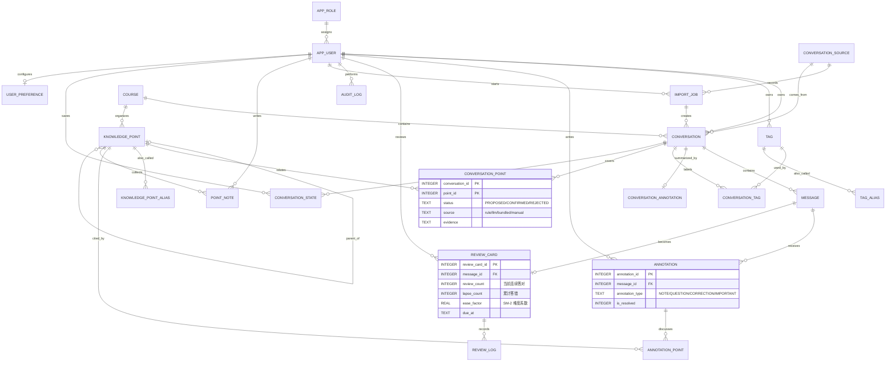

一个用户对同一条消息只能有一张复习卡（`UNIQUE(owner_id, message_id)`），图中按演示账户画成至多一张。

### 1.2 关系模式

完整 DDL 在 [schema.sql](../schema.sql)，`app.py` 启动时执行这一份文件，没有第二份建表定义。下表列出主要字段和约束。

| 表 | 主要字段 | 主键、外键和约束 |
| --- | --- | --- |
| `course` | course_id, course_code, course_name | PK course_id，course_code 唯一 |
| `knowledge_point` | point_id, course_id, parent_id, point_name | FK course_id、parent_id（自引用），UNIQUE(course_id, point_name) |
| `knowledge_point_alias` | alias_id, course_id, alias_name, point_id | UNIQUE(course_id, alias_name)，存知识点改名或被合并前的旧名 |
| `conversation_source` | source_id, platform_name, source_type | UNIQUE(platform_name, source_type)，ChatGPT 的 source_type 为 web_export |
| `import_job` | import_job_id, owner_id, source_id, file_name, source_conversation_id, status, result_code | 状态和结果码用 CHECK 限定取值 |
| `conversation` | conversation_id, owner_id, course_id, source_id, import_job_id, source_conversation_id, title, summary, started_at | 四个 FK，UNIQUE(owner_id, source_id, source_conversation_id) 用来查重 |
| `message` | message_id, conversation_id, seq_no, speaker, content, created_at | UNIQUE(conversation_id, seq_no)，speaker 限 user/assistant/system |
| `tag`、`conversation_tag` | tag_id, tag_name | 标签按用户唯一，会话与标签多对多 |
| `tag_alias` | alias_id, owner_id, alias_name, tag_id | UNIQUE(owner_id, alias_name)，存标签的旧名 |
| `conversation_point` | conversation_id, point_id, status, source, evidence, confirmed_by | 复合主键，status 限 PROPOSED/CONFIRMED/REJECTED |
| `conversation_annotation` | conversation_id, summary_manual, intent, topics_json 等 | 每个会话至多一条会话级标注 |
| `annotation` | annotation_id, message_id, author_id, annotation_type, content, is_resolved | 类型限四种，is_resolved 限 0/1 |
| `annotation_point` | annotation_id, point_id | 复合主键，一条批注可以关联同一门课的多个知识点 |
| `point_note` | point_note_id, point_id, author_id, content | 写在知识点页上、不依附任何消息的独立笔记 |
| `review_card` | review_card_id, message_id, owner_id, question, answer, due_at, interval_days, review_count, lapse_count, ease_factor, status | UNIQUE(owner_id, message_id)，ease_factor ≥ 1.3，lapse_count ≥ 0 |
| `review_log` | review_log_id, review_card_id, reviewed_at, grade, 复习前后的间隔、连续答对、到期时间和难度系数 | grade 限 correct/wrong |
| `conversation_state` | owner_id, conversation_id, is_favorite, last_message_id | 收藏和阅读位置 |
| `user_preference`、`audit_log`、`app_user`、`app_role` | | 界面设置、操作审计、固定演示账户 |

删除会话时，消息、关联和会话级标注级联删除。删除消息时，它的批注、批注和知识点的关联以及复习卡级联删除。合并两个知识点时，先把会话关联、批注关联和独立笔记都迁到保留的那一项，再删掉被合并的那一项，所以级联删除不会带走笔记。课程和知识点父节点用 RESTRICT，被引用时不能删。每次连接都打开 SQLite 外键检查，批量恢复结束前再跑 `PRAGMA integrity_check` 和 `PRAGMA foreign_key_check`，有问题整批回滚。`message_fts` 是 FTS5 全文索引，靠三个触发器和 `message` 表同步。

### 1.3 设计上的几个取舍

课程和知识点挂在会话上，不挂在消息上。老师的参考图把课程关联到消息，我们把一段完整的问答当作一个学习单元，因为一条消息脱离上下文往往看不懂。错题本里的每个错仍然精确到消息，所以从错能跳回原话。

`conversation_point` 带状态和来源。导入时的关键词规则、AI 建议和附带快照都只写 `PROPOSED`，学生确认后才变 `CONFIRMED`，拒绝的关系保留为 `REJECTED`，以后再建议也不会覆盖。错题本给每个会话选一个主知识点时，先取已确认的，再取待确认的，不用被拒绝的。

`conversation_point` 说的是“这段会话涉及这个知识点”，`annotation_point` 说的是“这条笔记讲的是这个知识点”，两者分开存。一段讲外键的会话里，学生可能在某条消息下顺手记了一句关于事务的疑问，这条疑问应该出现在“事务与并发”的笔记页上，而不必把整段会话也挂到事务下面。

标签和知识点改名或合并后，旧名记进 `tag_alias`、`knowledge_point_alias`，不直接丢掉。原因是附带快照、导入规则和 AI 建议里写的仍是旧名，按名字精确查找会再建出一条和合并结果重复的记录。所有按名字找词的地方（导入、恢复、AI 建议）都先查正式名，再查别名，最后按忽略大小写、全半角和空格的规范化写法比对。

`review_card` 同时存当前连续答对次数 `review_count` 和累计答错次数 `lapse_count`。前者决定下一次间隔，后者决定这张卡算不算常错卡。两者都能从 `review_log` 重算，测试逐张卡核对了这一点。旧数据库升级时，`lapse_count` 由已有日志里答错的次数回填。

## 二、聊天记录导入与存储

系统支持六种来源。五种 Agent 工具（Codex、Claude Code、Pi、DeepSeek CLI、Gemini CLI）从本机目录扫描，每个文件是一段对话。ChatGPT 网页版的数据导出是一个 `conversations.json`，里面是账户的全部对话。

ChatGPT 导出不是按顺序存消息，而是存成一棵树。用户每编辑一次提问、每重新生成一次回答，树就多一个分支，`current_node` 指向用户最后看到的那一条消息。`chatgpt_thread` 从 `current_node` 沿父节点走到根，再反转，得到界面上显示的那条线。工具调用、代码执行结果、隐藏的系统消息和推理过程不入库。测试用的导出样例里有一个被编辑掉的旧提问和一次代码执行，两者都不会出现在入库的消息里。

导入的每段对话在一个事务里写入：先按（用户，来源，原始会话 ID）查重，再建导入记录、会话、按序写消息，最后按关键词规则提出知识点。同一个 ChatGPT 导出可以反复上传，第二次预览时已入库的对话显示为“已存在，将跳过”。

## 三、逐功能需求拆解与实现

代码位置写到文件和函数，SQL 编号对应第四节。

### R01 记录导入

| 功能 | 输入、输出与异常 | 设计与实现位置 | 实现效果 |
| --- | --- | --- | --- |
| R01-F01 解析 Agent 会话文件 | 输入：本机 JSON/JSONL 文件，或 zstd 压缩的 `.jsonl.zst`<br>输出：来源 ID、标题、按序的用户/助手消息<br>没有正文时跳过并记原因，压缩帧不完整时按解析失败处理 | 按平台映射字段，删除运行时上下文，凭据脱敏；压缩文件用 Python `zstandard` 逐帧解压，每一帧都读到帧尾才算完整<br>`app.py:parse_conversation`、`zstd_decompressed_chunks`、`clean_import_text`、`redact_sensitive` | 单元测试覆盖 Codex、DeepSeek 的解析、脱敏和噪声过滤；截掉尾部、只剩半个文件、多帧文件末帧被截断时都不入库，换成完整文件重试可以成功 |
| R01-F02 解析 ChatGPT 网页导出 | 输入：`conversations.json`<br>输出：多段对话<br>不是导出格式时报错 | 沿 `current_node` 取可见分支，只留 text/multimodal_text<br>`app.py:parse_chatgpt_export`、`chatgpt_thread` | 编辑过的分支和工具调用被丢弃（S09） |
| R01-F03 查重与事务入库 | 输入：解析结果<br>输出：新增或跳过<br>重复来源 ID 跳过 | Q01 查重，一段对话一个事务；规则命中的知识点经 `ensure_point` 按别名解析<br>`app.py:import_parsed`、`scan_and_import`、`import_export_file` | 扫描本机或 `--import-file` 导入；“SQL 与查询”改名后，新导入的对话仍挂到改名后的知识点上 |
| R01-F04 上传预览与后台导入 | 输入：1–20 个文件<br>输出：逐段对话的新增/重复/无效预览，勾选后后台导入<br>超过 100 MB 返回 413 | 预览不写库，导入在后台线程逐段进行，可停止<br>`usability.py:preview_import`、`start_import`、`worker` | 一个 ChatGPT 导出展开成多行供勾选（S09） |
| R01-F05 恢复演示学期 | 输入：附带的对话快照和学习记录<br>输出：各表新增数量和完整性检查结果<br>冲突时整批回滚 | `app.py:read_bundle`、`restore_bundled`、`seed_demo_activity`，复习结果经 `apply_review` 重放 | `--demo` 在空库上恢复 90 段对话、559 条消息和全部学习记录，重复运行不重复写入 |

### R02 检索与阅读

| 功能 | 输入、输出与异常 | 设计与实现位置 | 实现效果 |
| --- | --- | --- | --- |
| R02-F01 多条件检索与分页 | 输入：关键词、课程、来源、知识点、批注状态、复习状态、页码<br>输出：本页会话、总数、命中片段 | Q02，过滤和 `LIMIT/OFFSET` 都在 SQL 里做<br>`app.py:conversations`、`learning_filters` | 每页 20 条，搜索结果显示命中的消息序号和片段（S06） |
| R02-F02 阅读上下文 | 输入：会话 ID<br>输出：按序消息、批注、复习卡、知识点、标签<br>不存在或不属于当前用户返回 404 | `app.py:conversation_detail`，前端 `static/app.js:openConversation` | 正文渲染 Markdown 和公式，从错题本跳来时定位到那条消息（S03） |

### R03 课程与知识点

| 功能 | 输入、输出与异常 | 设计与实现位置 | 实现效果 |
| --- | --- | --- | --- |
| R03-F01 规则提出知识点 | 输入：导入的对话<br>输出：`PROPOSED` 的知识点关联及命中的关键词 | 课程内的关键词规则，`app.py:POINT_RULES`、`import_parsed` | 关键词作为证据存在 `evidence` |
| R03-F02 AI 建议知识点 | 输入：会话 ID，或“所有未归类的会话”<br>输出：建议的知识点及理由，或改课建议<br>模型输出无法解析返回 502，不写库 | Q06，只写 `PROPOSED`，已有关系不覆盖，新知识点每次最多 1 个<br>`classify.py:suggest`、`apply` | 演示数据里 6 段未归类对话，模型的第一建议全部与出题时的知识点一致（R03 说明） |
| R03-F03 确认、拒绝与人工整理 | 输入：知识点决定，或课程、摘要、标签的修改<br>输出：更新后的关系，审计记录<br>标签名为空或超过 50 字返回 400 | `app.py:decide_point`、`remove_point`、`curate_conversation`，改课时会话和批注上的知识点都按名称迁移 | 人工修订在重复恢复快照时保留 |
| R03-F04 标签与知识点词库 | 输入：标签名，或某门课下的知识点名，可选“确认新建相近词”<br>输出：已有词及使用次数；新建、复用或合并的结果<br>和已有词相近又没确认时返回 409 和候选列表 | Q08；`vocabulary.py:normalize_term`、`term_relation`、`create_or_get_tag`、`create_or_get_point`、`merge_points`，前端 `static/vocabulary.js` | 输入框一聚焦就列出已有词；“外键”和“外键约束”这类包含关系或相似度达 0.82 的名字要先确认；合并后旧名留作别名（S10） |

AI 建议只在学生点按钮时运行，因为它要把会话的标题、摘要和前约 3000 字发给大模型。演示学期里有 6 段对话故意没挂知识点，一次批量建议提出 10 个关联。每段的第一个建议都和生成数据时写的知识点一致，第二个建议多半牵强，比如因为示例代码是 Python，就给一段讲测试覆盖率的对话加了“Python 与调试”。这是建议只写 `PROPOSED`、等学生确认的原因。没配 key 时退回关键词规则。模型给出的知识点名也先经词库解析，旧名和写法变体都落到已有的那一项上。

### R04 批注与错题本

| 功能 | 输入、输出与异常 | 设计与实现位置 | 实现效果 |
| --- | --- | --- | --- |
| R04-F01 消息级批注 | 输入：消息 ID、类型（笔记/疑问/AI 答错/重点）、内容<br>输出：批注记录和审计<br>类型非法或内容为空返回 400，不属于当前用户返回 403 | 批注单独成表，不改原消息<br>`app.py:create_annotation`、`update_annotation` | 疑问和 AI 答错可以标“弄懂了”，也能重新打开（S04） |
| R04-F02 错题本汇总 | 输入：掌握情况（没掌握/已攻克/全部）、类型、课程<br>输出：按知识点分组、按优先级排序的错，以及总数和本周进出 | Q03，三种错各一条查询，按主知识点归组<br>`errorbook.py:mistakes` | 首页（S01、S02） |
| R04-F04 批注关联知识点与知识点笔记页 | 输入：批注的 `point_ids`；或知识点 ID 和独立笔记内容<br>输出：批注关联的知识点；知识点页上按时间合并分页的消息笔记和独立笔记<br>知识点不属于该会话的课程返回 400，笔记超过 4000 字返回 400 | Q09；`app.py:validate_annotation_points`、`knowledge_point_notes`、`create_point_note` | 批注下列出它关联的知识点，点名字进入该知识点的笔记页，消息笔记附原消息摘要和“查看原消息”（S11） |
| R04-F03 从错题出卡 | 输入：疑问或纠错的 ID，可选的题目和答案<br>输出：立即到期的复习卡<br>不是疑问或纠错返回 404 | 疑问用原文作题目、消息作答案，纠错用纠错内容作答案<br>`errorbook.py:card_from_mistake` | 出卡后错题旁显示“已有卡” |

### R05 复习

| 功能 | 输入、输出与异常 | 设计与实现位置 | 实现效果 |
| --- | --- | --- | --- |
| R05-F01 从消息建卡 | 输入：消息 ID、题目、答案<br>输出：立即到期的卡<br>同一消息再建卡返回原卡，进度不变 | Q04 的 `ON CONFLICT DO NOTHING`<br>`app.py:create_review` | 建卡后马上能在复习队列里做 |
| R05-F02 SM-2 调度与复习日志 | 输入：卡 ID、答对或答错<br>输出：新的间隔、连续答对、难度系数、到期时间<br>卡已暂停返回 400 | 纯函数算下一次，更新卡和写日志在同一事务<br>`app.py:schedule_next`、`apply_review`、`complete_review` | 先看题、空格揭晓、`1`/`2` 评分（S05） |

SM-2 是 1987 年 SuperMemo 软件提出的间隔重复算法，Anki 长期使用的调度就是它的变体。原算法让用户在 0–5 分里打分，我们只有答对和答错两档，所以简化为：答错时间隔回到 1 天、连续答对清零、难度系数减 0.2（下限 1.3）。答对时第一次间隔 3 天，之后每次乘以难度系数，上限 365 天。一张从没答错的卡间隔依次是 3、8、20、50 天，答错过两次的卡难度系数是 2.1，依次是 3、6、13、27 天。

### R06 统计与导出

| 功能 | 输入、输出与异常 | 设计与实现位置 | 实现效果 |
| --- | --- | --- | --- |
| R06-F01 分布统计 | 输出：课程、来源、知识点的会话数，累计复习次数和答对答错 | Q07，`LEFT JOIN` 保留没有记录的课程<br>`app.py:stats` | 统计页（S07） |
| R06-F02 每周错题进出 | 输入：周数<br>输出：每周新记下的错、弄懂的错、复习次数和答对次数 | Q05，递归 CTE 生成连续的周，没有数据的周补 0<br>`errorbook.py:weekly` | 统计页的周表（S07） |
| R06-F03 导出与完整备份 | 输出：当前库 JSON、单门课 Markdown、完整 SQLite 备份；恢复前先校验并保存当前库 | `app.py:export_json`、`export_course`，`usability.py:download_backup`、`restore_backup` | 完整备份包含批注、复习历史和收藏 |

### R07 Text2SQL

| 功能 | 输入、输出与异常 | 设计与实现位置 | 实现效果 |
| --- | --- | --- | --- |
| R07-F01 只读执行 | 输入：模型生成的 SQL<br>输出：列名和至多 200 行<br>不是单条 SELECT/WITH 返回 400 | 关键字校验、只读连接、SQLite authorizer 只放行读操作、执行步数上限<br>`text2sql.py:validate_sql`、`run_readonly` | 即使校验被绕过，写操作也会被 authorizer 拒绝 |
| R07-F02 C3 生成 | 输入：中文问题<br>输出：SQL、结果和诊断（召回的表和列、投票分布） | `text2sql.py:generate_c3`，没配 key 时用模板 | 问答页（S08），评测见第六节 |

## 四、关键 SQL

参数都通过 SQLite 参数绑定传入，下面为了可读写成命名参数。

### Q01 来源会话查重

```sql
SELECT conversation_id FROM conversation
WHERE owner_id = :owner AND source_id = :source AND source_conversation_id = :original_id;
```

### Q02 检索、筛选与分页

```sql
SELECT c.conversation_id, c.title, s.platform_name, co.course_name, COUNT(m.message_id) AS message_count,
       (SELECT COUNT(*) FROM annotation a JOIN message am ON am.message_id = a.message_id
        WHERE am.conversation_id = c.conversation_id AND a.is_resolved = 0) AS unresolved_count
FROM conversation c
JOIN conversation_source s ON s.source_id = c.source_id
JOIN course co ON co.course_id = c.course_id
LEFT JOIN message m ON m.conversation_id = c.conversation_id
WHERE c.owner_id = :owner
  AND (c.title LIKE :kw ESCAPE '\' OR EXISTS (SELECT 1 FROM message sm
       WHERE sm.conversation_id = c.conversation_id AND sm.content LIKE :kw ESCAPE '\'))
  AND EXISTS (SELECT 1 FROM conversation_point cp WHERE cp.conversation_id = c.conversation_id AND cp.point_id = :point)
GROUP BY c.conversation_id
ORDER BY c.updated_at DESC, c.conversation_id DESC
LIMIT :limit OFFSET :offset;
```

没有给出的条件整行省略。总数用同一组条件单独 `COUNT(*)`。

### Q03 错题本：主知识点与三种错

每个会话的主知识点：已确认优先，其次待确认，同级取编号最小的。

```sql
SELECT cp.conversation_id, kp.point_id, kp.point_name
FROM conversation_point cp JOIN knowledge_point kp ON kp.point_id = cp.point_id
WHERE cp.status IN ('CONFIRMED','PROPOSED')
  AND kp.point_id = (SELECT cp2.point_id FROM conversation_point cp2
                     WHERE cp2.conversation_id = cp.conversation_id AND cp2.status IN ('CONFIRMED','PROPOSED')
                     ORDER BY cp2.status = 'CONFIRMED' DESC, cp2.point_id LIMIT 1);
```

疑问和 AI 答错来自批注，常错卡来自复习卡，两条查询都左连接上面的主知识点（下记作 `pp`）。

```sql
SELECT CASE a.annotation_type WHEN 'QUESTION' THEN 'question' ELSE 'correction' END AS kind,
       a.annotation_id, a.content, a.is_resolved, m.seq_no, c.title, pp.point_name
FROM annotation a
JOIN message m ON m.message_id = a.message_id
JOIN conversation c ON c.conversation_id = m.conversation_id
LEFT JOIN (/* 主知识点 */) pp ON pp.conversation_id = c.conversation_id
WHERE c.owner_id = :owner AND a.annotation_type IN ('QUESTION','CORRECTION');

SELECT 'card' AS kind, r.review_card_id, r.question,
       (r.review_count >= 3 OR r.status = 'COMPLETED') AS is_resolved,
       r.lapse_count, (r.status = 'ACTIVE' AND r.due_at <= CURRENT_TIMESTAMP) AS overdue, pp.point_name
FROM review_card r
JOIN message m ON m.message_id = r.message_id
JOIN conversation c ON c.conversation_id = m.conversation_id
LEFT JOIN (/* 主知识点 */) pp ON pp.conversation_id = c.conversation_id
WHERE r.owner_id = :owner AND r.lapse_count > 0 AND r.status <> 'SUSPENDED';
```

分组和优先级在 Python 里算（`errorbook.py:mistakes`），因为同一组错要按“没掌握在前、逾期在前、疑问在前”多重排序，写成 SQL 窗口函数反而难读。

### Q04 建卡、评分与复习日志

```sql
INSERT INTO review_card(message_id, owner_id, question, answer, due_at)
VALUES(:message, :owner, :question, :answer, datetime('now'))
ON CONFLICT(owner_id, message_id) DO NOTHING;

-- 评分：一个事务内先更新卡，再写日志
UPDATE review_card
SET review_count = :streak, interval_days = :interval, ease_factor = :ease,
    lapse_count = lapse_count + :is_wrong, due_at = :due, last_reviewed_at = :now, status = 'ACTIVE'
WHERE review_card_id = :card;
INSERT INTO review_log(review_card_id, reviewed_at, grade, interval_before, interval_after,
                       streak_before, streak_after, due_before, due_after, ease_before, ease_after)
VALUES(:card, :now, :grade, :old_interval, :interval, :old_streak, :streak, :old_due, :due, :old_ease, :ease);
```

### Q05 每周错题进出

```sql
WITH RECURSIVE week(start) AS (
    SELECT date('now', '-6 days', 'weekday 1', :back)
    UNION ALL SELECT date(start, '+7 days') FROM week
    WHERE start < date('now', '-6 days', 'weekday 1')
),
noted AS (
    SELECT date(a.created_at, '-6 days', 'weekday 1') AS wk, COUNT(*) AS n
    FROM annotation a JOIN message m USING(message_id) JOIN conversation c USING(conversation_id)
    WHERE c.owner_id = :owner AND a.annotation_type IN ('QUESTION','CORRECTION') GROUP BY wk
)
SELECT week.start, COALESCE(noted.n, 0) AS noted /* 弄懂的、复习次数同理 */
FROM week LEFT JOIN noted ON noted.wk = week.start ORDER BY week.start;
```

`date(x, '-6 days', 'weekday 1')` 先退 6 天，再前进到下一个周一，结果是 x 所在那一周的周一，x 本身是周一时不变。测试用一个周一和它前一天的周日核对了分组。

### Q06 AI 建议只写待确认关系

```sql
INSERT OR IGNORE INTO conversation_point(conversation_id, point_id, confidence, source, status, evidence)
VALUES(:conversation, :point, 0.8, 'llm', 'PROPOSED', :reason);
```

主键是（会话，知识点），所以已经确认或拒绝的关系不会被这条语句改动。

### Q07 课程分布

```sql
SELECT co.course_name, COUNT(DISTINCT c.conversation_id) AS conversations, COUNT(m.message_id) AS messages
FROM course co
LEFT JOIN conversation c ON c.course_id = co.course_id AND c.owner_id = :owner
LEFT JOIN message m ON m.conversation_id = c.conversation_id
GROUP BY co.course_id;
```

### Q08 词库：使用次数与合并

```sql
SELECT t.tag_id, t.tag_name, COUNT(DISTINCT c.conversation_id) AS conversation_count
FROM tag t
LEFT JOIN conversation_tag ct ON ct.tag_id = t.tag_id
LEFT JOIN conversation c ON c.conversation_id = ct.conversation_id AND c.owner_id = :owner
WHERE t.owner_id = :owner
GROUP BY t.tag_id;

-- 合并：会话关联挪到目标，旧名记为目标的别名，再删掉源标签
INSERT OR IGNORE INTO conversation_tag(conversation_id, tag_id)
SELECT conversation_id, :target FROM conversation_tag WHERE tag_id = :source;
UPDATE tag_alias SET tag_id = :target WHERE tag_id = :source;
INSERT INTO tag_alias(owner_id, alias_name, tag_id) VALUES(:owner, :source_name, :target)
ON CONFLICT(owner_id, alias_name) DO UPDATE SET tag_id = excluded.tag_id;
DELETE FROM tag WHERE tag_id = :source;
```

知识点合并多一步：同一段会话同时挂着源和目标时，保留状态更靠前的那条（已确认优先于待确认，待确认优先于已拒绝）。

### Q09 知识点笔记页

```sql
SELECT 'message' AS source, a.annotation_id AS id, a.content, a.created_at, m.message_id, c.title
FROM annotation_point ap
JOIN annotation a ON a.annotation_id = ap.annotation_id
JOIN message m ON m.message_id = a.message_id
JOIN conversation c ON c.conversation_id = m.conversation_id
WHERE ap.point_id = :point AND c.owner_id = :owner
UNION ALL
SELECT 'point', pn.point_note_id, pn.content, pn.created_at, NULL, NULL
FROM point_note pn WHERE pn.point_id = :point AND pn.author_id = :owner
ORDER BY created_at DESC LIMIT :limit OFFSET :offset;
```

两类笔记的列数和含义对齐后用 `UNION ALL` 合并，翻页在 SQL 里做。

## 五、页面截图

S01–S09 由 `tests/browser_check.py --capture-report` 在临时数据库上跑 `--demo` 后拍摄，拍摄时新增了一条疑问，ChatGPT 导入只预览没有入库。S10、S11 分别由 `tests/vocabulary_browser_check.py`、`tests/annotation_points_browser_check.py` 在 5 段测试用会话上拍摄。

### S01 错题本

错题本默认只列没掌握的错。演示学期里有 25 个疑问没弄懂、7 处 AI 答错待核对、10 张卡还不稳，分在 17 个知识点下，最近 7 天新记下 7 个、弄懂 6 个，累计攻克 50 个。排在最前的“索引与查询优化”组有 2 个疑问和 2 张常错卡，两张卡一张今天到期、一张逾期 2 天，优先级为 2×3 + 2×2 + 2×1 = 12。

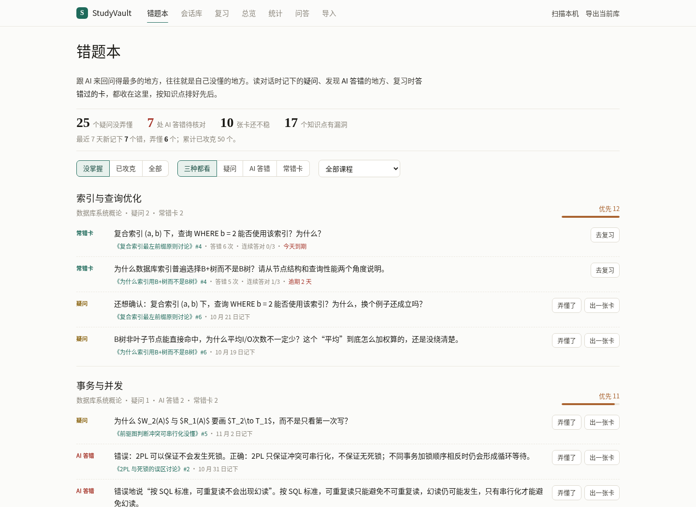

### S02 只看 AI 答错

只看 AI 答错时剩下 7 条，每条是学生写下的纠错原文。组的顺序仍按全部没掌握的错计算优先级，所以“事务与并发”排在最前，它除了这 2 处 AI 答错还有 1 个疑问和 2 张常错卡，优先级为 11。


### S03 跳回原消息

点一条 AI 答错的来源，会话库打开那段对话并定位到出错的消息，红色批注是学生写的纠错。

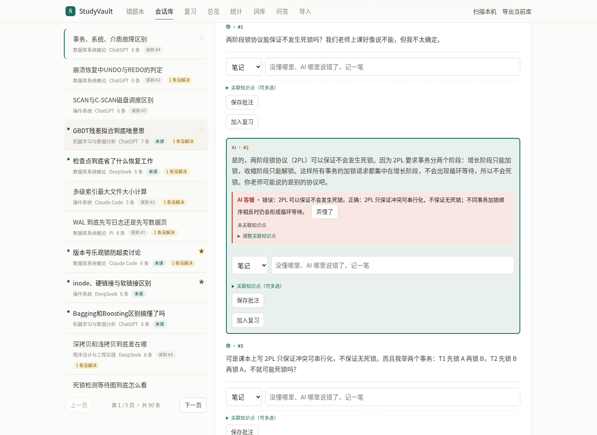

### S04 记一条新疑问

在第一条用户消息下选“疑问”并保存，批注立刻显示在消息下面，错题本里同时多出一条。

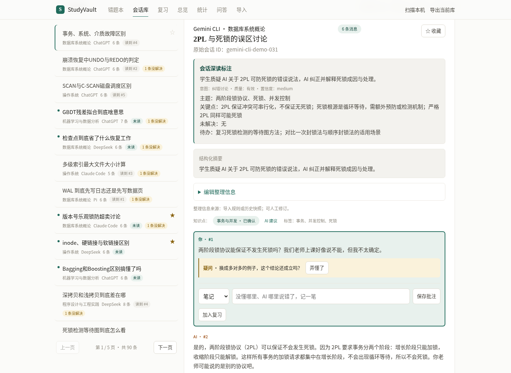

### S05 复习

复习队列里今天有 6 张卡到期。第一张已按空格翻开答案，按 2 记答对、按 1 记答错，结果交给 SM-2 算出下一次的间隔。每张卡下方注明课程、来源会话和当前连续答对的次数。

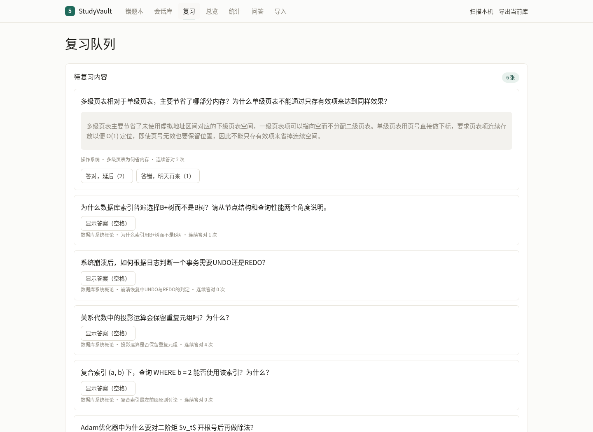

### S06 会话库

会话库左边是会话列表，每行标出是否读过、读到第几条和还有几条批注没解决。右边打开的是《2PL 与死锁的误区讨论》，上方是会话标注和知识点，“AI 建议”按钮只在点击时把这段对话发给大模型。第 1 条消息下的黄色批注是 S04 里新记的疑问。

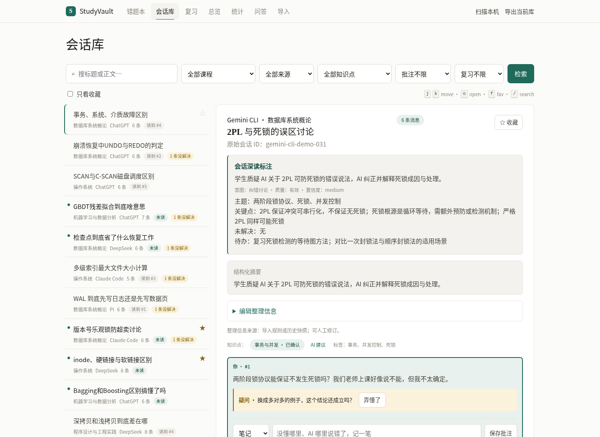

### S07 统计

统计页汇总整个演示学期：累计复习 353 次，答对 245 次、答错 108 次。三列分别是各课程、各来源平台和各知识点的会话数，会话最多的课程是数据库系统概论，38 段。

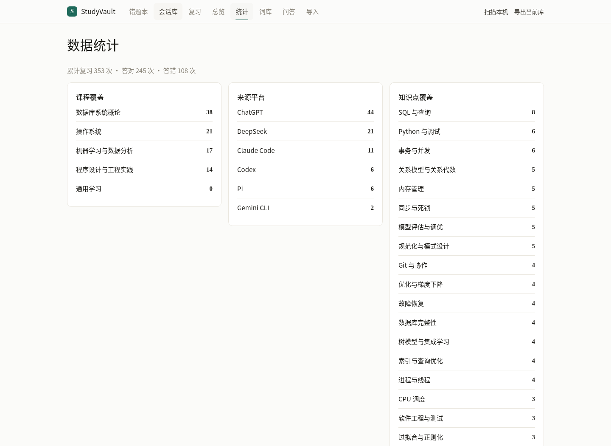

### S08 问答

问题是“哪门课我还没弄懂的疑问最多？”。C3 召回了 6 张表，5 条采样都能执行，按结果分成两组，取 4 票那组的 SQL，答案是数据库系统概论 11 个。SQL 下方的召回表、召回列和投票方块对应 C3 的三个步骤。

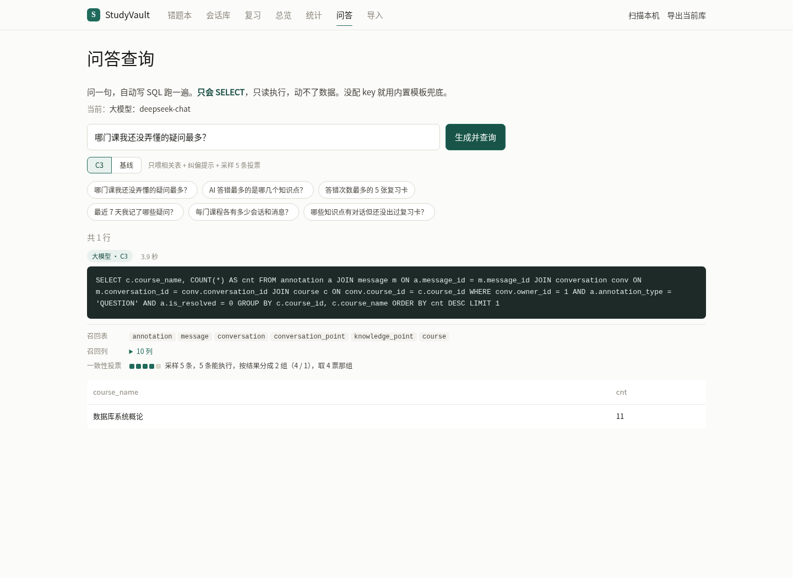

### S09 导入 ChatGPT 导出

上传测试用的 `conversations.json`，预览展开成两段对话，都识别为 ChatGPT。只有系统消息的第三段没有出现在列表里。

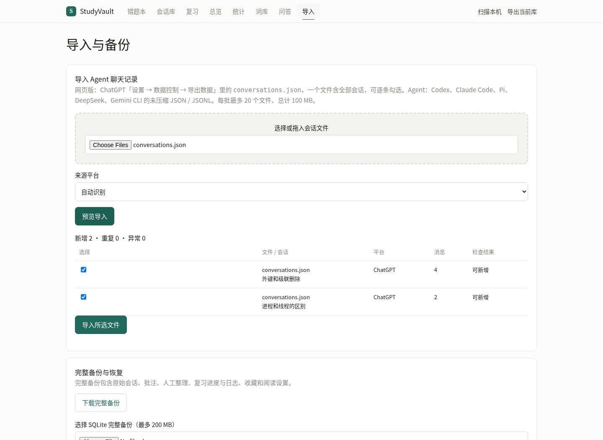

### S10 词库

先建标签“外键”，再输入“外键约束”时界面提示已有相近标签，确认后新建，再把它合并进“外键”。合并后列表里只剩“外键”，旧名“外键约束”显示为别名。

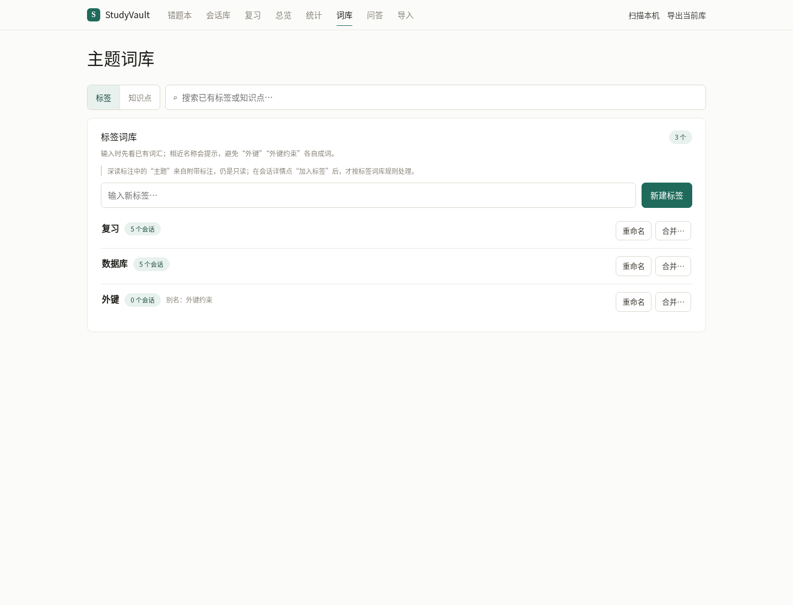

会话详情里的标签和知识点都从词库里选，输入框旁注明同名会复用、相近名称会先提示。上方知识点条目的名字本身是链接，点它进入该知识点的笔记页。

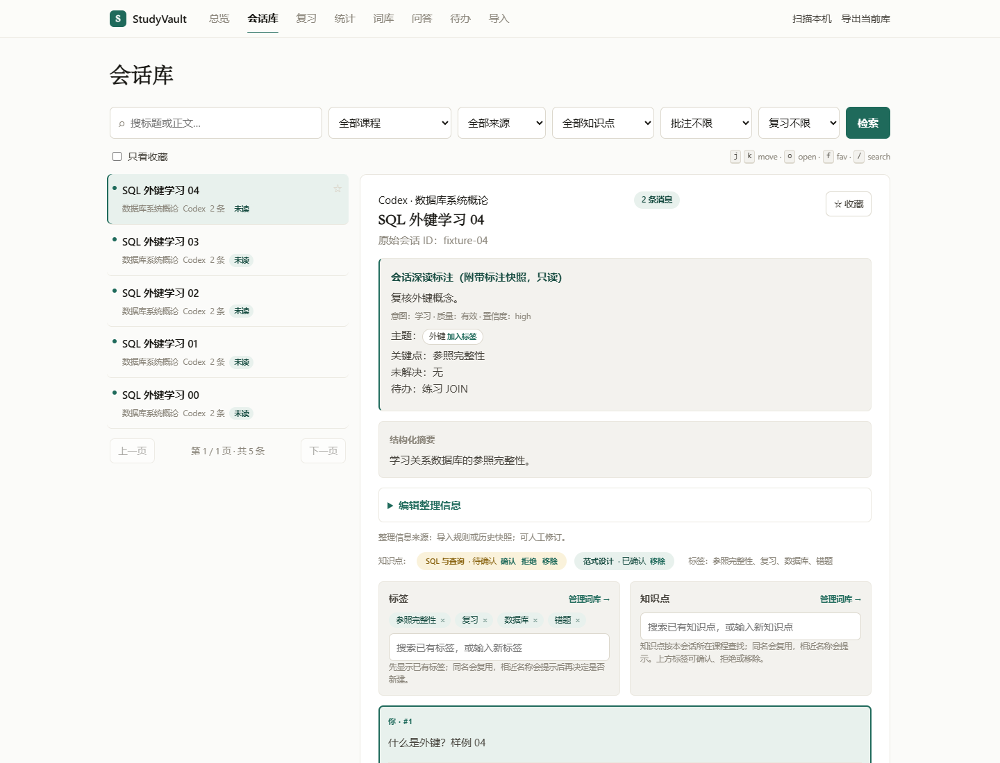

### S11 批注关联知识点

在第 1 条消息下记一条笔记，同时勾选“SQL 与查询”和“数据库完整性”，笔记下方列出这两个知识点。进入“SQL 与查询”的笔记页，这条消息笔记和一条直接写在页面上的独立笔记按时间排在一起，消息笔记带着原消息摘要。

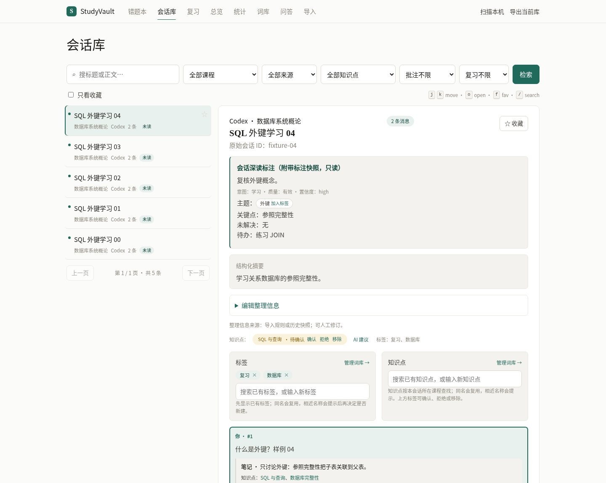

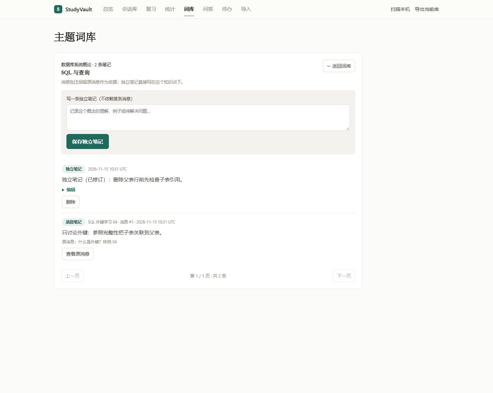

## 六、Text2SQL 评测

### C3 是什么

C3 出自 Dong 等人 2023 年的论文《C3: Zero-shot Text-to-SQL with ChatGPT》，是一种不训练模型、只靠提示词的方法，在 Spider 基准的测试集上取得了当时零样本方法的最好成绩。它由三部分组成：

- 清晰提示（Clear Prompting）：先让模型从全部表里挑出和问题相关的表，再挑相关的列，生成 SQL 时只给这部分结构。
- 校准提示（Calibration with Hints）：在提示里写明模型常犯的错，比如问“多少”时不要把被计数的列也选出来。
- 一致性输出（Consistent Output）：采样多条 SQL，各自执行，按结果分组，取票数最多的那组。

我们的实现在 `text2sql.py`，模型是 `deepseek-chat`，采样 5 条，温度 0.7。基线是同一个模型拿到完整表结构后直接生成一条 SQL。

### 评测怎么做

题目在 `eval/text2sql_cases.jsonl`，每题有中文问题和我们手写的标准 SQL。指标是执行准确率：生成的 SQL 和标准 SQL 在同一个库上执行，结果的值多重集合相同就算对，不比较列名、行序和列序。报错、未通过安全校验都算错。评测库和 `--demo` 一样，在临时目录构建。

题目分两档：

- 基础题 18 道，如“一共有多少张复习卡”“每门课程各有多少会话”，多数只涉及一两张表。
- 学习者题 22 道，是学生对着错题本会问的问题，如“哪门课我还没弄懂的疑问最多”“逾期超过 3 天还没复习的卡有哪些”“每门课的复习正确率”，需要四五张表的连接、时间窗口、比例或反连接。

### 结果

下表是同一套题的三次运行。C3 每题采样 5 条，温度 0.7，所以每次结果略有不同。第 3 次运行的逐题 SQL 和诊断见 `eval/text2sql_eval_result.md`。

| 运行 | 基础题·基线 | 基础题·C3 | 学习者题·基线 | 学习者题·C3 | 合计·基线 | 合计·C3 | 平均耗时（基线 / C3） |
| --- | --- | --- | --- | --- | --- | --- | --- |
| 1 | 16/18 | 16/18 | 22/22 | 20/22 | 38/40 | 36/40 | 3.4 / 11.1 秒 |
| 2 | 16/18 | 16/18 | 21/22 | 19/22 | 37/40 | 35/40 | 4.6 / 11.2 秒 |
| 3 | 15/18 | 16/18 | 21/22 | 19/22 | 36/40 | 35/40 | 2.7 / 8.7 秒 |

C3 在学习者题上比基线少对 1 到 2 道，错在 Q27、Q36 和 Q40 三题。Q27、Q40 三次全错，Q36 错了两次，基线这三题三次都对。三题错的原因相同：C3 只把召回到的表和列给模型，召回漏掉了连接必经的表或主键列，模型就臆造列名或绕路连接。

- Q40 问每门课各有多少张卡至少答错过一次。复习卡要经 `message` 表连到会话，会话再按 `course_id` 连到课程，C3 三次召回的表里都没有 `message`。模型三次都改从课程经知识点关联绕到会话，没有关联知识点的会话就被漏掉，数据库系统概论数出 18 张，正确答案是 19 张，漏掉的那张卡所在的会话没有关联知识点。
- Q36 问还有多少条待确认的会话-知识点关联。召回只留下 `conversation_point` 一张表，校准提示又要求会话统计加 `conversation.owner_id = 1`。模型看不到 `conversation` 的列，有的采样就写出不存在的 `conversation.id`，执行失败。
- Q27 问每门课的复习正确率，同样漏掉了 `message`。候选 SQL 没有正确的连接条件，结果行数成倍膨胀，被执行步数上限中止，或得出错误的比例。

基础题上两种方法各错 2 到 3 道，多数是输出形状和标准答案不同。Q5 和 Q12 的基线 SQL 多选了一列 `course_id`，Q12 的 C3 SQL 只给课程编号、没有课程名，Q10 两种方法都把答对和答错次数排成一行两列。执行准确率要求结果的值完全一致，所以这几题即使查询逻辑对也算错。

C3 只给相关表的设计在表很多、问题只涉及其中少数几张时能减少干扰。我们的库只有 18 张表，完整结构加外键不长，基线拿到全部外键就能找到连接路径，召回漏表的损失大于它减少的干扰。我们推测，召回之后把连接路径上的中间表和主键、外键列补回去，C3 在学习者题上能追平基线，这一点还没有验证。

这套题还有两处限制。Q25 和 Q26 在当前演示数据上的标准答案是空集，一条什么都查不出的 SQL 也算对，所以这两题区分不了方法。三次运行只用了 `deepseek-chat` 一个模型，题目也只有 40 道，一两道的差距在随机波动范围内，三次运行里稳定出现的是 C3 在 Q27、Q36、Q40 上的错误。

## 七、测试

单元测试 110 项，用临时数据库，不读个人目录，涉及大模型的部分用替身。五套浏览器检查在真实浏览器里走完主要流程，包括错题本里标弄懂、从已攻克里重新打开、跳回原消息、在词库里合并相近词、给批注勾选知识点。几项和本报告结论直接相关的测试：

- 每张演示复习卡的当前状态都等于重放它自己的复习日志的结果，相邻两次复习首尾相接（`tests/test_errorbook.py`）。
- 错题本的分组、优先级、连续答对 3 次攻克、被拒绝的知识点不参与分组（同上）。
- ChatGPT 导出的分支选择、工具调用过滤、重复上传跳过（`tests/test_chatgpt_export.py`）。
- AI 建议不覆盖已确认或已拒绝的关系，改课建议不写入知识点，模型输出坏了不写库（`tests/test_classify.py`）。
- 告诉 Text2SQL 模型的每一列都真实存在于 `schema.sql`（`tests/test_text2sql.py`）。
- 相近词不确认就不新建；改名、合并后旧名留作别名，再恢复快照、再导入、AI 再用旧名建议时都落到保留的那一项（`tests/test_vocabulary.py`、`tests/test_import_aliases.py`、`tests/test_classify.py`）。
- 合并知识点时批注关联和独立笔记随之迁移，跨课程的关联被拒绝（`tests/test_annotation_points.py`）。
- 截断或损坏的 zstd 压缩会话不会部分入库，用完整文件重试可以成功（`tests/test_zstd_import.py`）。

## 限制

- 固定一个本地演示账户，没有登录和权限。
- 一段会话只属于一门课，跨课程的对话只能靠知识点和标签补充。
- 同一来源会话后续新增的消息不会增量同步，只能整段重新导入。
- 演示对话是合成的。经过推理模型核查不等于没有错误，核查本身也会漏判。
- 错题本的优先级权重（3、2、2、1）是我们定的，没有用真实学习数据验证过它是否比按时间排序更有用。
- 作者的 754 段真实对话以编程和科研任务为主，按关键词规则归课时 456 段落在“程序设计与工程实践”。真实对话能不能像演示数据那样整齐地按课程整理，还没验证过。

## 与 AI 编码工具协作

本项目在 Claude Code 协助下完成。下面是几项由我们决定、影响设计的取舍：

| 议题 | 选择与理由 |
| --- | --- |
| 演示数据 | 真实对话含个人信息，仓库只放合成数据。合成数据用大模型生成后再用推理模型核查，因为生成的“正确”回答里也会混进计算错误，比如时间片轮转的周转时间算错 |
| 错题本是否单独建表 | 不建表，从已有表实时算。好处是不会和批注、复习卡的状态不一致，代价是每次打开要跑几条连接查询，在演示规模下一次约 11 毫秒 |
| AI 建议的触发方式 | 只在点按钮时调用，导入时不自动调用，因为它会把对话内容发给外部模型 |
| 复习调度 | 从固定的 3/7/14 天改成 SM-2，让答错的次数影响以后的间隔，常错卡才真的会更常出现 |
