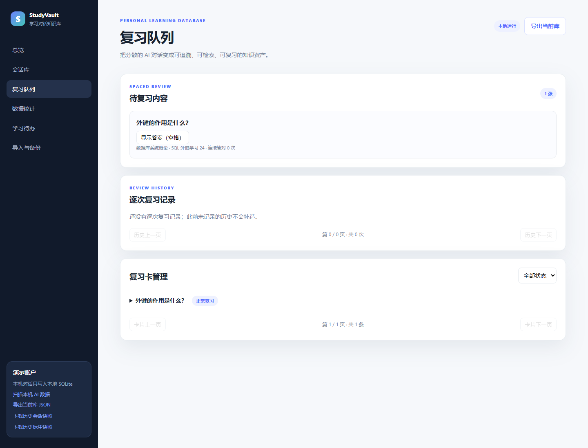
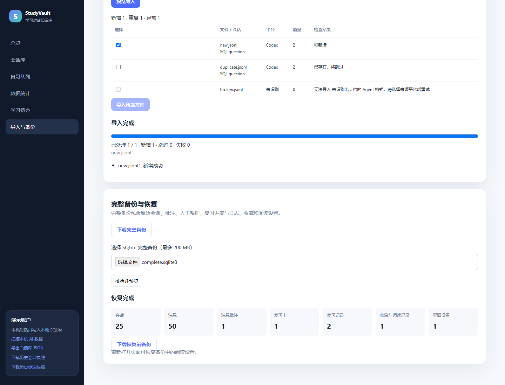
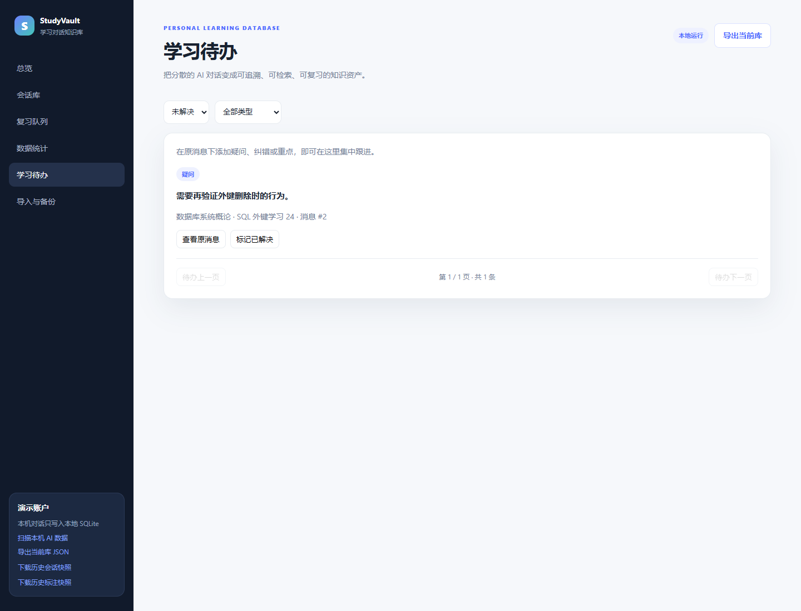
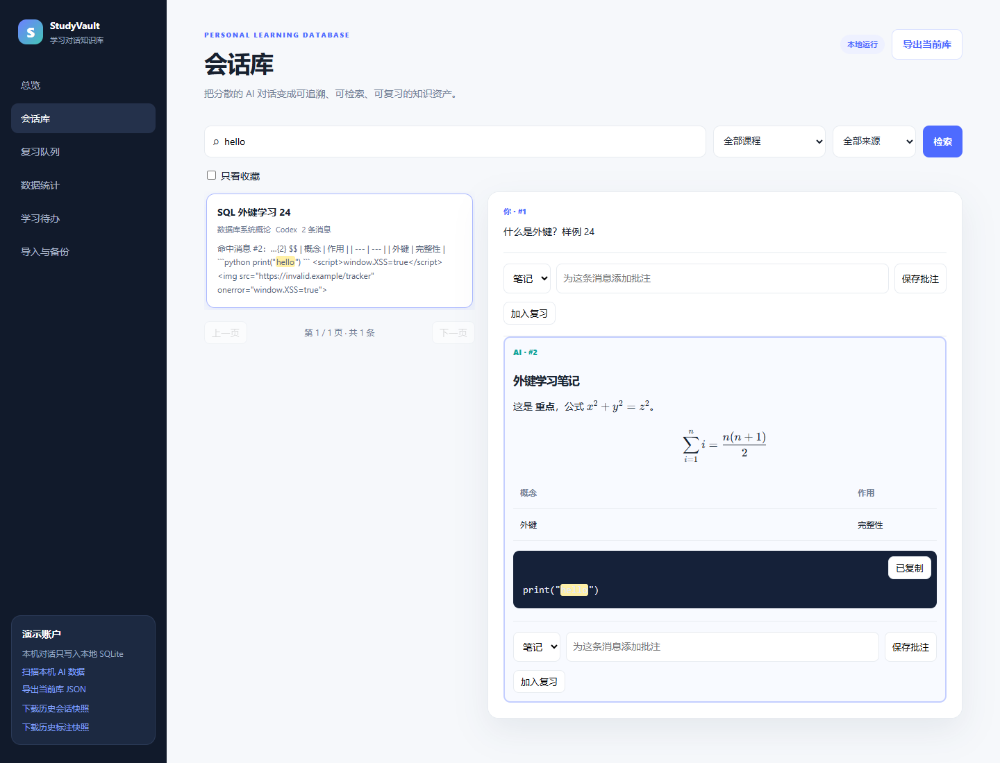
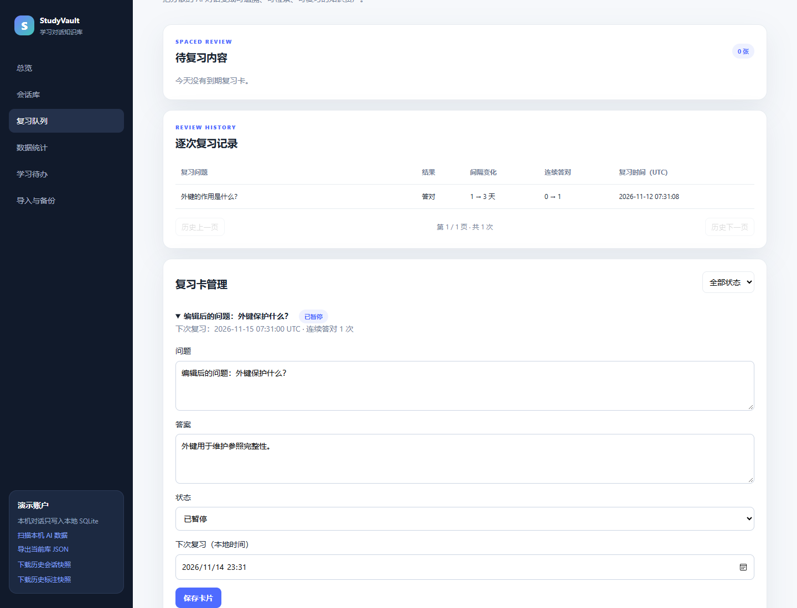
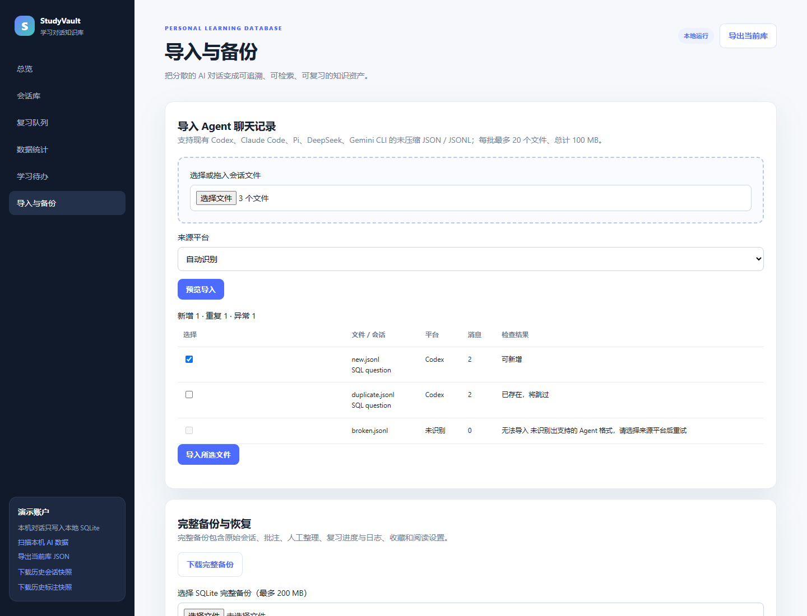
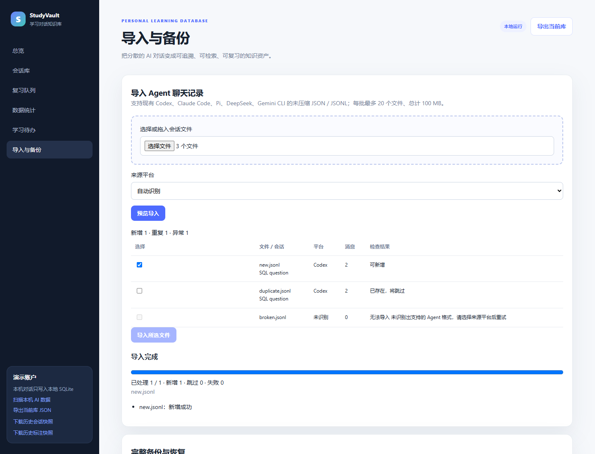

# StudyVault 七项可用性增强

## 1. 实施计划与完成情况

实施前的范围、顺序、接口与验收条件见 [实施计划](USABILITY_PLAN.md)。本轮落实全部七项，复用已有 SQLite/FastAPI，不引入云服务或大模型 API。

| 编号 | 功能 | 状态 | 入口 |
| --- | --- | --- | --- |
| U01 | 先回忆再揭晓答案，支持复习快捷键 | 已实现 | 复习队列。 |
| U02 | 完整备份、上传校验预览、确认恢复及恢复前备份 | 已实现 | 导入与备份。 |
| U03 | 学习待办、解决/重开与原消息跳转 | 已实现 | 学习待办。 |
| U04 | Markdown、公式、表格、代码块与代码复制 | 已实现 | 会话正文、揭晓后的复习答案。 |
| U05 | 复习卡编辑、暂停/恢复、到期日期调整 | 已实现 | 复习队列 → 复习卡管理。 |
| U06 | 收藏筛选、最近阅读及界面/消息位置恢复 | 已实现 | 会话详情、只看收藏、总览最近阅读。 |
| U07 | 文件导入预览、选中入库、处理进度及停止后续文件 | 已实现 | 导入与备份。 |

## 2. U01：先回忆，再显示答案

新卡仍立即到期。初始只显示问题和“显示答案”；点击或按空格后，才显示参考答案及答对/答错按钮。保留已有调度和逐次日志。

- 空格：揭晓当前第一张待复习卡。
- `1`：揭晓后答错；`2`：揭晓后答对。
- 在文本框、下拉框、按钮或可编辑文本中操作时不截获快捷键，长按不会反复评分。
- 这是学习交互约束；评分 API 保持原有请求字段，没有把答案当作需要保密的数据。

参考 [Anki 的问题/答案复习流程](https://docs.ankiweb.net/manual/studying)。实现位置为 `static/app.js:loadReviews` 和 `static/usability.js` 的键盘处理。



## 3. U02：完整数据库备份与恢复

### 下载与确认流程

“下载完整备份”通过 SQLite backup API 生成自包含 `.sqlite3` 文件，包含库内全部表：问答、来源、人工整理审计、消息批注、复习卡和日志、收藏、阅读位置与界面偏好。

恢复分两步：

1. 上传完整备份，检查 SQLite 文件头、表结构、当前账户、数据库完整性及外键；页面展示会话、消息、批注、卡片等数量，此时不修改当前库。
2. 用户勾选替换当前数据并点击“确认恢复此备份”。程序先完整保存当前库，再恢复已校验快照；页面提供“下载恢复前备份”。恢复后若检查失败，会从恢复前快照回退。

### 接口与边界

| 接口 | 输入/输出 |
| --- | --- |
| `GET /api/backup` | 下载当前库的完整 SQLite 快照。 |
| `POST /api/backup/preview` | multipart 的 `file`；返回预览令牌、数量及需要确认的标记。 |
| `POST /api/backup/restore` | JSON `token`；应用该预览，返回恢复数量与恢复前备份下载 URL。 |
| `GET /api/backup/safety/{backup_id}` | 下载该恢复操作前保存的快照。 |

备份上传上限为 200 MB，预览令牌一小时有效且绑定当前数据库，成功恢复后失效。拒绝其他类型数据库、不兼容结构、触发器/视图及完整性错误。兼容基础旧库缺少后续附加表的情况，先在临时副本补齐附加 DDL。

服务使用数据库操作锁配合 SQLite backup API，标准运行方式为本地单进程 Uvicorn；不配置多个 worker。运行中或排队中的文件导入需先结束/停止，才能恢复。恢复前快照保存在数据库旁被 Git 忽略的 `backups/` 中；下载用的临时快照在传输后关闭并清理。

完整备份包含数据库内所有状态，不打包外部 Agent 源文件、静态历史 JSONL 或正在运行的临时导入任务。固定历史快照下载、当前库会话 JSON 和课程 Markdown 三种原有导出继续可用，各自范围保持明确。

实现位置：`usability.py:create_router` 中的 `snapshot`、`validate_backup`、`download_backup`、`preview_backup`、`restore_backup`；数据库连接锁在 `app.py:connect`。依据：[SQLite Online Backup API](https://www.sqlite.org/backup.html)、[Python sqlite3 backup](https://docs.python.org/3/library/sqlite3.html#sqlite3.Connection.backup)。



## 4. U03：集中跟进学习待办

复用用户消息批注：QUESTION 为疑问、CORRECTION 为待纠错、IMPORTANT 为重点/待练习。普通 NOTE 不自动进入待办，也不把历史深读标注中的推断问题直接变成用户任务。

- 支持未解决、已解决、全部状态和类型筛选，每页 20 条。
- 点击“查看原消息”打开对应会话并定位批注所指向的消息。
- 点击“标记已解决”或“重新打开”，更新 `annotation.is_resolved` 并记录审计，原始消息保持不变。
- `GET /api/todos` 返回分页列表；`PATCH /api/annotations/{annotation_id}` 接受 `is_resolved` 布尔值，检查所属会话的用户范围。

实现位置：`usability.py:todos`、`resolve_todo`，`static/usability.js:loadTodos`。



## 5. U04：排版阅读与代码复制

会话正文和揭晓后的复习答案支持 Markdown 标题、粗体、列表、引用、表格、代码块，以及 `$...$` / `$$...$$` / `\(...\)` / `\[...\]` 数学公式。代码块有独立复制按钮，复制的是代码文本。

原始消息仍按原文保存在 SQLite；搜索按原始正文进行，高亮在排版后的文本节点上应用。公式和代码排版不改变来源 ID、消息内容或后续批注关系。

Marked 负责 Markdown，DOMPurify 过滤 HTML，KaTeX 排版公式。脚本、样式、图片及外部嵌入不自动执行或加载；公式使用不受信任模式并限制展开。前端依赖及字体均随仓库本地提供，页面运行不访问 CDN。版本、许可证和上游地址见 [第三方清单](../static/vendor/THIRD_PARTY.md)，许可证文本随库保留。

实现位置：`static/render.js:StudyRender.render`、`copyText`；挂接在 `static/app.js` 的消息/复习答案渲染中。



## 6. U05：复习卡可维护

“复习卡管理”可按正常复习、暂停、已完成筛选并分页。展开卡片可编辑问题、答案、状态和下次到期日期。

- 暂停卡片不再进入待复习队列，恢复后按到期时间进入队列。
- 编辑和暂停均保留卡片 ID、连续答对次数、复习间隔及已有逐次日志；编辑本身不伪造一次复习。
- 日期控件显示本地时间，提交时转换为带时区时间，服务端统一保存为 UTC；问题答案要求非空。
- API：`GET /api/reviews/cards`；`PATCH /api/reviews/cards/{card_id}`；当前非 ACTIVE 卡片不能通过评分 API 继续答题。

实现位置：`usability.py:cards`、`edit_card`，`static/usability.js:loadCards`。



## 7. U06：收藏与继续阅读

会话详情提供收藏/取消收藏，会话库可勾选“只看收藏”；总览显示最近打开的会话及继续阅读入口。

新增两张表，当前共 18 张表：

| 表 | 字段与约束 | 用途 |
| --- | --- | --- |
| `conversation_state` | 复合主键 owner_id/conversation_id；FK 到用户、会话和最近消息；is_favorite 为 0/1；last_opened_at 保存时间。 | 收藏、最近阅读和消息位置。 |
| `user_preference` | PK/FK user_id；library_state 为序列化界面状态。 | 关键词、课程/来源、收藏筛选、页码、会话和上次视图。 |

接口为 `POST /api/library/favorite`、`POST /api/library/progress`、`GET /api/library/recent`、`GET/POST /api/preferences`。会话查询增加 `favorites_only` 可选参数。用户只能标记自己拥有的会话，阅读消息必须属于该会话。

刷新后先加载保存的界面条件，再打开原会话并恢复消息位置。显式搜索/待办跳转优先于上次位置；用户滚轮、触摸或阅读滚动键触发位置保存，跳转和点击界面控件造成的程序滚动不会误改阅读位置。界面退出时补发最后一次状态，持久数据纳入完整备份。

实现位置：`schema.sql`、`usability.py` 的收藏/进度/偏好接口，以及 `static/usability.js:trackConversation`、`savePreferences`。


## 8. U07：导入前可检查，导入中可跟进

### 用户流程

1. 选择或拖入文件，选择自动识别或已有平台。
2. 页面预览标题、平台、消息数量、新增/重复/异常，默认只勾选可新增的文件；此时不写学习数据。
3. 用户选择文件后启动后台任务，显示已处理/总数、新增/跳过/失败及当前文件。重复项会在入库时再次查重。
4. 每个文件独立事务。一个失败不伪装成整批成功；失败原因列在结果中。
5. “停止后续文件”在当前文件事务完成后停止，不回滚已经成功的文件。页面刷新后可在同一浏览器会话继续查看任务。

### 支持格式与限制

支持现有 Codex、Claude Code、Pi、DeepSeek、Gemini CLI 的未压缩 Agent JSON/JSONL，会话元数据使用稳定 ID；支持 UTF-8 BOM。每批 1–20 个文件，总计不超过 100 MB。不支持的网页平台导出或压缩文件会明确说明，不作为空白成功导入。

预览和任务仅在本服务进程内有效，令牌绑定当前数据库，预览一小时有效；服务重启后需要重新预览。导入已提交的会话仍在 SQLite 中，不因临时任务状态丢失而删除。浏览器进度依据已完成文件数，不编造剩余时间。

| 接口 | 输入/输出 |
| --- | --- |
| `POST /api/import/preview` | multipart `files` 和 `platform`，返回预览令牌、候选列表与三类数量。 |
| `POST /api/import/tasks` | JSON `preview_token`、所选 `selected` 索引，返回 task_id。 |
| `GET /api/import/tasks/{task_id}` | 返回任务状态、处理数量及逐文件结果。 |
| `POST /api/import/tasks/{task_id}/cancel` | 请求停止后续文件。 |

实现位置：`usability.py:detect_platform`、`preview_import`、`start_import`、`worker`；复用 `app.py:import_parsed` 的事务与查重。原有本机扫描及 `--restore-bundled` 保持独立入口，不自动扫描个人目录。





## 9. 验证与证据

```powershell
uv run --group dev python -m unittest discover -s tests -v
uv run --group dev python tests/browser_check.py
uv run --group dev python tests/additional_browser_check.py
uv run --group dev python tests/usability_browser_check.py
```

后端当前 **34/34 通过**：原 24 项加本轮 10 项，验证待办、卡片状态/进度保留、收藏与消息范围、完整备份往返、无效备份不改库、预览不提前写入、导入取消与恢复互斥、格式错误、数据库令牌绑定和 BOM/平台识别。

三套真实 Edge 浏览器检查通过。新增检查验证七项功能、复制代码、两种公式、含脚本/图片输入的过滤，以及完整备份恢复前后的数量与旧库快照。页面 JavaScript 错误和外部页面请求均为 0。

结构化证据：[USABILITY_EVIDENCE.json](USABILITY_EVIDENCE.json)。本页 8 张截图由新增浏览器检查自动拍摄，使用 25 个受控会话、1 个临时新增会话及临时库的备份往返；不把这些样例当成历史语料或学习效果用户实验。测试在独立临时库中进行，不触碰本机真实数据；仓库附带的是合成演示快照（见 DATA_POLICY.md）。
